# 詳細設計(ホゴタロウ)

技術: Java 25 / Spring Boot 4.1.1（Spring MVC・Spring Security・Spring Data JPA・Bean Validation）/ JSP + JSTL / MySQL / Lombok。ビルドは Maven（`mvnw`）。画面は Bootstrap 5.3.8 と Google Fonts の Zen Maru Gothic を CDN から読み込む。個体の写真の切り抜きに Cropper.js 1.6.2（CDN）。

<br>

1. [共通仕様](#chapter1)
2. [トップページ](#chapter2)
3. [個体管理](#chapter3)
4. [イベント管理](#chapter4)
5. [里親管理](#chapter5)
6. [スタッフ管理](#chapter6)
7. [エラー](#chapter7)
8. [付録（DDL、初期データ、状態遷移図）](#chapter8)

<br>
<a id="chapter1"></a>

## 1. 共通仕様

### 1.1 この文書の読み方

- 画面は `S-xx`（基本設計1章「画面一覧」の No）。例: S-03 個体一覧
- 機能は `F-xx`（基本設計3章「URL設計」の No）。例: F-05 GET /animal
- 各章は「画面 → 機能」の順。画面はカンプの画像と表で説明する。新規登録と編集は同じ JSP を共用するので、カンプは新規登録の1枚だけ載せる（編集は同じレイアウトに現在値が入る）
- フォームの表の「name」は Form クラスのフィールド名（= `<form:input path>` の値）。「タグ・型」の `text, maxlength=10` は `<input type="text" maxlength="10">` の意味

### 1.2 ログインと権限

- ログインは Spring Security に任せる（`POST /login` と `POST /logout` の Controller は書かない）
- `LoginUserDetailsService`（`UserDetailsService` を実装）が `staffRepository.findByLoginId(loginId)` で staff を引き、Spring Security 標準の `User`（ログインIDとロール）を返す。ロールは `user_types.code`（`ADMIN` `STAFF` `VOLUNTEER`）を `.roles()` で付ける。自作の `UserDetails` クラスは作らない
- パスワードは BCrypt。`SecurityConfig` に `PasswordEncoder` の Bean（`new BCryptPasswordEncoder()`）を置き、スタッフ登録時は `passwordEncoder.encode(平文)` を保存する
- `LoginUser`（`security` パッケージ、`@Component`）は、ログイン中のスタッフの情報を返す窓口。Controller に注入して使い、全画面の JSP には `LoginUserModelAdvice`（`@ControllerAdvice`）が `loginUser` という名前で渡す。メソッドは `getOrganizationId()`・`getOrganization()`・`getStaffId()`・`getOrganizationName()`・`getName()`・`getRole()`・`getUserTypeName()`・`isLoggedIn()`。団体IDは常に `loginUser.getOrganizationId()` から取る
- `SecurityConfig` の設定
  - `.formLogin()`: `loginPage("/login")`、`loginProcessingUrl("/login")`、`usernameParameter("loginId")`、`passwordParameter("password")`、`defaultSuccessUrl("/", true)`、`failureUrl("/login?error")`
  - `.logout()`: `logoutUrl("/logout")`、`logoutSuccessUrl("/login?logout")`
  - CSRF 対策は既定のまま有効。POST は `<form:form>` で書く（トークンの hidden が自動で入る）。`<form:form>` を使わない form は `<input type="hidden" name="${_csrf.parameterName}" value="${_csrf.token}">` を書く
  - URL ごとの権限は、範囲の狭いものから順に書く（上から順に評価されるため）

|順|対象|権限|
|:---:|---|:---:|
|1|`DispatcherType.FORWARD` `DispatcherType.ERROR`|`permitAll()`（JSP への転送と error.jsp の表示）|
|2|`/login` `/css/**` `/js/**` `/img/**` `/images/**`|`permitAll()`（ログイン前の画面・スタイル・ロゴ）|
|3|`/logout`|`authenticated()`|
|4|`/staff/new` `/staff/*/edit` `/*/*/delete`|`hasRole("ADMIN")`|
|5|`/*/new` `/*/*/edit`|`hasAnyRole("ADMIN", "STAFF")`（登録・編集フォームは GET でも S）|
|6|`HttpMethod.POST, "/**"`|`hasAnyRole("ADMIN", "STAFF")`|
|7|`.anyRequest()`|`authenticated()`（残りの GET はログイン済みなら誰でも）|

- 画面のボタンは `<sec:authorize access="...">` で出し分ける。新規登録・編集・完了・未対応に戻すは `hasAnyRole('ADMIN','STAFF')`、削除とスタッフの新規登録は `hasRole('ADMIN')`。ボランティアにはスタンプ欄の代わりに対応状況を文字で出す（`hasRole('VOLUNTEER')`）。個体一覧の「新規登録」とスタッフ詳細の「編集」「削除」は `${loginUser.role}` を `<c:if>` で見る（スタッフの削除はさらに `${staff.id != loginUser.staffId}` のときだけ）
- 個体の削除（F-11）は、Controller でも `loginUser.getRole()` が `ADMIN` でなければ 403 にする

### 1.3 団体の絞り込み

基本設計8章のとおり。Controller が `loginUser.getOrganizationId()` を取り、Service の引数で渡す。1件取得は必ず `findByIdAndOrganizationId(id, 団体ID)`、空なら Service が `throw new ResponseStatusException(HttpStatus.NOT_FOUND)`（404）。プルダウンで選んだ個体・里親の ID も `findByIdAndOrganizationId` で引き直す。登録するときの団体は `organizationRepository.getReferenceById(団体ID)` でセットする。

団体を持たないマスタ（`breeds` `event_types` `user_types`）は `findById` で引く。`organizations` はログイン中の団体だけを `findById(loginUser.getOrganizationId())` で読む。

### 1.4 フラッシュメッセージとエラー

基本設計8章のとおり。

- フラッシュは、登録・編集・削除などの POST のあとに `redirectAttributes.addFlashAttribute("message", "…")` で渡し、リダイレクト先で1回だけ表示する。属性名は全画面 `message`（個体の定員のメッセージだけは `capacityFull`。3章）
- 表示は各 JSP が `<c:if test="${not empty message}">` で書く。色は個体・イベントが `alert-success`、里親・スタッフが `alert-warning`
- 入力エラーはフラッシュではなく、同じフォームを再表示して項目の下に出す（1.5）
- 403・404 などは error.jsp（7章）

### 1.5 入力チェックの書き方

- Form に `@NotBlank` `@Size` `@NotNull` `@Email` `@Pattern` `@Past` `@PastOrPresent` `@PositiveOrZero` を付け、メッセージはアノテーションに直接書く（例: `@NotBlank(message = "名前を入力してください")`）。検索用の `XxxSearchForm` には付けない
- 各章の表の `@Pattern("...")` は略記。実際は `@Pattern(regexp = "...", message = "...")` と書く。任意項目の形式チェックは `^$|` を先頭に付けて空を通す。表の中の `\|` は Java では `|`
- Controller は `@Validated XxxForm xxxForm, BindingResult result` で受け、`result.hasErrors()` なら同じフォームを再表示する（選択肢と `mode` を Model に入れ直す）
- アノテーションで書けないチェックは Service で判定する。エラーがあれば保存せずに戻り、Controller は同じフォームを再表示する。書き方は2通り
  - `BindingResult` を Service に渡し、`result.rejectValue("項目名", "コード", "メッセージ")` で載せる: スタッフ（ログインID必須・重複、パスワード必須、ユーザー種別の存在確認、自分自身のユーザー種別の変更）、イベント（個体・種別・里親の存在確認、保護中でない個体、トライアル開始・譲渡の里親必須、猫の狂犬病ワクチン）
  - 個体は、Service が `AnimalValidationException`（`AnimalService` の中に定義。項目名・エラーコード・メッセージを持つ）を投げ、Controller が `catch` して `result.rejectValue(e.getField(), e.getErrorCode(), e.getMessage())` に載せる: 犬猫と品種の組み合わせ、トライアル中・譲渡済の里親必須、犬の狂犬病ワクチン。選んだ品種・里親が存在しないときは 404
- 日付は `<input type="date">` + `LocalDate` + `@DateTimeFormat(iso = DateTimeFormat.ISO.DATE)`、時刻は `<input type="time">` + `LocalTime` + `@DateTimeFormat(pattern = "HH:mm")`
- プルダウン・ラジオは enum の定数名を送り、表示は `label`（例: `${a.status.label}`）。マスタ・他テーブルの選択（品種・個体・イベント種別・里親・ユーザー種別）は ID を送る
- 任意の文字列項目が空（空文字、または空白だけ）なら、Service で `null` にして保存する（`blankToNull()`。イベントは `emptyToNull()`）
- 写真は JSP の `accept="image/jpeg,image/png"` で選べるファイルを絞り、送信前に Cropper.js が切り抜いて JPEG にする（3章 S-05）。サーバー側では種類のチェックをしない

### 1.6 標準画面遷移（個体・里親・イベント・スタッフ共通）

ヘッダー: 全画面で表示（`common/header.jspf`）。左からロゴ（クリックでトップ）/ 個体管理 / イベント管理 / 里親管理 / スタッフ管理  <br>右端にログイン中の「団体名 / 名前（ユーザー種別名）」/ ログアウト（POST フォーム）。今開いている画面のメニューは白背景・太字（`active`）になる。ログイン前の画面（ログイン画面・ログイン前のエラー画面）では、ロゴだけの帯にし、ロゴはリンクにしない

|遷移元|操作|遷移先|
|:---:|:---:|:---:|
|一覧|「新規登録」| 新規登録画面（GET /xxx/new）|
|一覧| カード（個体）・名前（里親・スタッフ）をクリック | 詳細（GET /xxx/{id}）|
|詳細|「編集」|編集画面（GET /xxx/{id}/edit）|
|詳細|「削除」|確認 → POST /xxx/{id}/delete → 一覧へ。フラッシュ「〇〇を削除しました」|
|新規登録|「登録する」|POST /xxx/new → 詳細へ。フラッシュ「〇〇新規登録が完了しました」|
|編集|「更新する」|POST /xxx/{id}/edit → 詳細へ。フラッシュ「〇〇を編集しました」|
|新規登録・編集| 入力エラー | 同じフォームを再表示 |
|新規登録・編集| 「キャンセル」 | 新規 → 一覧、編集 → 詳細 |

〇〇は「個体」「里親」「イベント」「スタッフ」。

各機能の章では、この表と**違うところだけ**書く。主な違い:

- イベント: 一覧はカレンダー（S-07）で、イベントを押すと概要ペインが開く。新規登録と削除のあとは詳細ではなく、そのイベントの月のカレンダー（`/event?year=&month=`）へ戻る
- 里親: 個体またはイベントに紐づいている里親は削除せず、詳細へ戻してフラッシュ「個体またはイベントに紐づいているため削除できません」
- スタッフ: 自分自身は削除できない（詳細に削除ボタンを出さず、POST されても詳細へ戻してフラッシュ「自分自身は削除できません」）。登録・更新のボタンは「登録」「更新」
- 個体: 定員に達しているときは、新規登録画面と登録・編集後の詳細画面にメッセージを出す（登録・更新は止めない。3章）

### 1.7 命名

基本設計8章のとおり。追加分:

- Controller のメソッドは `list` `detail` `newForm` `create` `editForm` `update` `delete`（イベントだけ `complete` `uncomplete`、トップは `top` `login`）
- Service のメソッドは `search` `create` `update` `delete`（イベントはさらに `complete` `uncomplete`）と、1件取得、編集フォーム用の `getEditForm`（取得した Entity の値を Form に詰めて返す）、関連一覧や選択肢の `findXxxList`。トップは `TopService` の `countInCare` `findOrganization`
- 入力フォームは `XxxForm`、Model 名は `xxxForm`。検索条件は `XxxSearchForm`、Model 名は `searchForm`。登録・編集の共用 JSP には `mode`（`"new"` / `"edit"`）と編集対象の ID（`animalId` `adopterId` `eventId`。スタッフは Entity の `staff`）を渡す。一覧・選択肢は `xxxList`
- BOOLEAN のフィールドは、誕生日推定だけ `is` を付けた `isBirthdayEstimated`（Entity・Form とも。列は `is_birthday_estimated`）。それ以外（`done` `comboVaccine` `rabiesVaccine`）は `is` を付けない
- 避妊去勢は enum `NeuterStatus`（`DONE` 済 / `NOT_DONE` 未 / `UNKNOWN` 不明）で、列名・フィールド名とも `neutered`

### 1.8 共通部品

- `jsp/common/head.jspf`: 全画面が `<head>` の中で include する。taglib 宣言、`ctx`（コンテキストパス）、meta、ファビコン、Bootstrap、Zen Maru Gothic、共通CSS `/css/hogotarou.css`。`<title>` は各ページで書く。個体フォームだけは Cropper.js の css と js も読み込む
- `jsp/common/header.jspf`: 全画面が `<body>` の直後で include する。ロゴ、ナビ、ログイン中の「団体名 / 名前（ユーザー種別名）」、ログアウトの `<form:form>`。ログイン中かどうかは `${loginUser.loggedIn}` で見て、ログイン前はロゴだけの帯にする。ヘッダー用の CSS はこのファイルの `<style>` に持つ。フラッシュは表示しない（各画面で表示する）
- `jsp/common/message.jspf`: フラッシュを表示する部品（`_template` が使う）
- `jsp/_template/list.jsp` `detail.jsp` `form.jsp`: 画面を作るときにコピーして使う見本。`★` の付いた所と `○○`・`xxx` を書き換える
- `static/css/hogotarou.css`: 共通スタイル（配色の CSS 変数、カード `hogo-card`、ボタン `btn-hogo` `btn-hogo-sub` `btn-hogo-danger`、表 `table-peach`、件数 `hogo-count`、0件の案内 `hogo-empty`、改行を保つ `hogo-notes`、定員のメッセージ `hogo-dialog` など）
- `static/images/`: ロゴ、`favicon.ico`、`apple-touch-icon.png` など。URL は `/images/...`
- 削除・完了・未対応に戻すの確認は、form の `onsubmit="return confirm('...')"` で出す。文言は、里親・スタッフ・イベントの削除「本当に削除しますか？」、個体の削除「この個体を削除してもよろしいですか？」、イベントの完了「イベントを完了にしますか？個体の情報は自動では変わりません」、未対応に戻す「イベントを未対応に戻しますか？個体の情報は自動では変わりません」
- 定員のメッセージ（S-04・S-05）は JavaScript を使わず `<dialog open class="hogo-dialog">` で出し、「閉じる」は `<form method="dialog">` のボタンで閉じる
- 写真が無い個体は `/NoPhotos/NoPhotos.png`（犬猫共通。プロジェクト直下の `uploads/NoPhotos/` から配信）を出す
- 年齢は Entity（Animal・Adopter・Staff）の `@Transient getAge()` で誕生日から計算する。誕生日が無ければ null（表示は「不明」または「-」）

<br>
<a id="chapter2"></a>

## 2. トップページ

### 2.1 画面（S-01 〜 S-02）

#### S-01 ログインページ（login.jsp）

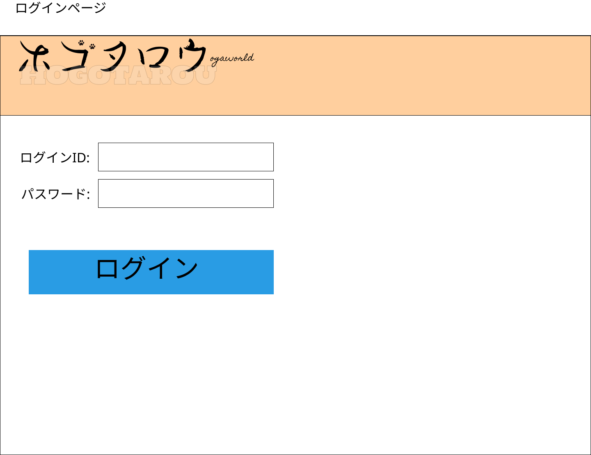

|項目|name|タグ・型|必須|備考|
|:---:|:---:|:---:|:---:|:---:|
|ログインID|loginId|text|○|`required` `autofocus`|
|パスワード|password|password|○|`required`|
|ログイン|なし|submit||横幅いっぱいのボタン|
|メッセージ|なし|なし||`?error` で「ログインに失敗しました」（`alert-danger`）、`?logout` で「ログアウトしました」（`alert-success`）。JSP で `${param.error != null}` `${param.logout != null}` を見て表示する|

`<form:form action="/login" method="post">` で書き、入力欄は `<input name="loginId">` `<input name="password">`（ログイン用の Form クラスは無い）。見出しは「ログイン」、カードの見出しは「ログイン情報」。ヘッダーはロゴだけの帯になる。

#### S-02 トップページ（top.jsp）

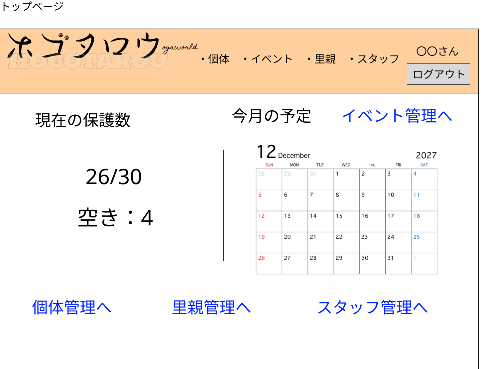

|表示項目|内容|備考|
|:---:|:---:|:---:|
|個体管理へ/イベント管理へ/里親管理へ/スタッフ管理へ|リンク（ボタン）|S-03/S-07/S-11/S-15へ。見出しの下に横並び|
|保護頭数：受け入れ状況|「満員」「残りわずか」「受け入れOK」とアイコン（✕ / ! / ✓）、「空き N 頭」|空き = 定員 − 保護中。空きが0以下なら「満員」（赤）、使用率80%以上なら「残りわずか」（黄）、それ以外は「受け入れOK」（緑）。空きはマイナスにせず0と出す|
|保護頭数：保護中 / 定員|`${inCare}` / `${organization.capacity}` 頭|保護中は `Status.inCare()` の4つ（保護中(譲渡可)・保護中(譲渡不可)・入院中・トライアル中）の合計|
|保護頭数：使用状況のバー|Bootstrap の progress と「N% 使用中」|使用率 = 保護中 ÷ 定員（定員が0なら0）。「N% 使用中」は小数点以下を丸める。バーは100%で止める|
|ミニカレンダー|見出し「カレンダー（yyyy年m月）」。日〜土の表で、マスに日付とその日のイベント|今月（日本時間）だけを表示し、月の切り替えは無い。前月・次月のはみ出したマスは文字を薄くし、そこにもその日のイベントを出す。1日に3件以上あるマスは、マスの中で縦スクロールにする|
|ミニカレンダーのイベント|「個体名 種別（未）」または「個体名 種別（済）」。時刻は出さない|色は対応状況で変える（未対応＝オレンジ、対応済＝緑）。押すと `/event?year=&month=&selectedEventId=`（そのイベントの月のイベント管理のカレンダーで、そのイベントを選んだ状態で開く）|

見出しは「トップページ」。ボタンの下に2列で、左（PC では 4/12）に「保護頭数」カード、右（8/12）にカレンダーのカードを並べる（スマホでは縦1列）。フラッシュの表示は無い。

### 2.2 機能（F-01 〜 F-04）

#### F-01 GET /（TopController#top）
1. 団体ID = `loginUser.getOrganizationId()`
2. 保護頭数 = `topService.countInCare(団体ID)`（`animalRepository.countByOrganizationIdAndStatusIn(団体ID, Status.inCare())`）
3. 団体 = `topService.findOrganization(団体ID)`（`organizationRepository.findById`、無ければ 404）。受入上限はこの団体の `capacity`
4. `eventService.search(団体ID, null, null)` で今月の `EventCalendar` を作る（F-12 と同じ）
5. Model: `inCare`、`organization`、`calendar` → top.jsp

`TopService` は保護頭数と団体の取得をまとめたクラス。個体の定員のメッセージ（F-07・F-08・F-10）でも使う。

#### F-02 GET /login（TopController#login）
1. ログイン済み（`loginUser.isLoggedIn()`）なら `redirect:/`。それ以外は login.jsp を返す。

#### F-03 POST /login、F-04 POST /logout（Controller 無し）
Spring Security に任せる（設定は 1.2）。F-03 は成功したら `/`、失敗したら `/login?error`。F-04 はログアウトしたら `/login?logout`。

<br>
<a id="chapter3"></a>

## 3. 個体管理

### 3.1 画面（S-03 〜 S-06）

#### S-03 個体一覧（animal/list.jsp）

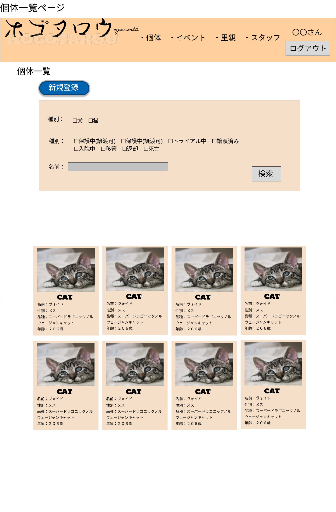

カード形式で個体の一覧を表示する（カードは `hogo-card`、写真は `hogo-card-img`。高さ 200px）。

- 検索フォーム（見出し「個体を検索」）: 種別（犬猫）・保護状況（どちらもチェックボックスで複数選択）と、名前（部分一致の text。placeholder「個体名を入力してください」）。保護状況の初期値は `Status.inCare()` の4つ。検索ボタンは `<button type="submit" name="search" value="1">`
- カードの上に件数「検索結果 N 件」（Model の `resultCount`）。0件のときはカードの代わりに「該当する個体はいません」
- フラッシュ（`${message}`）は `alert alert-success`

|表示項目|内容|備考|
|---|---|---|
|写真|`${animal.imagePath}`、無ければ `/NoPhotos/NoPhotos.png`（alt「画像なし」）|犬猫の出し分けは無く、共通の1枚|
|名前|`<c:out value="${animal.name}"/>`| カード全体を `/animal/{id}` へのリンクにする|
|犬猫|`${animal.species.label}`|バッジ|
|性別|`${animal.sex.label}`|バッジ|
|保護状況|`${animal.status.label}`|バッジ|
|品種|「品種：」+ `${animal.breed.name}`|品種が無ければ「-」|
|年齢|「年齢：」+ `${animal.age}歳`|年齢が null なら「-」|

|操作|権限|遷移先|
|---|:---:|---|
|新規登録ボタン|S|S-05|
|カードクリック|V|S-04|
|検索ボタン|V|S-03（条件つき）|

#### S-04 個体詳細（animal/detail.jsp）

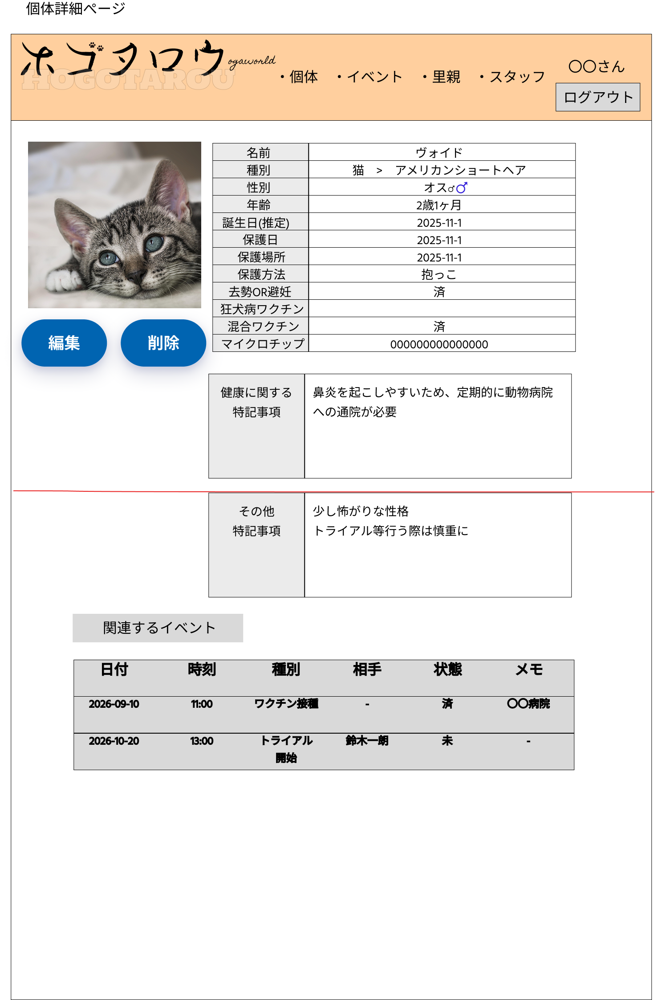

幅 700px までの1列で、カードを「基本情報」「保護情報・健康情報」「イベント履歴」の3枚並べる。フラッシュ（`${message}`）は `alert alert-success`。

登録・編集で保護頭数が定員に達したとき（F-08・F-10）はフラッシュ `capacityFull` が届くので、`<dialog open class="hogo-dialog">` で「保護頭数が定員に達しています。トップページの受け入れ状況を確認してください。」と「閉じる」ボタンを出す。

|表示項目|内容|
|---|---|
|写真|「基本情報」カードの先頭に1枚（最大幅 300px）。無ければ `/NoPhotos/NoPhotos.png`（alt「写真なし」）|
|基本（「基本情報」カード）|名前・種別（犬猫）・性別・品種（無ければ「不明」）・年齢（無ければ「不明」）・誕生日（推定のときは後ろに「（推定）」。無ければ「不明」）|
|保護（「保護情報・健康情報」カード）|保護日・保護場所・保護方法・保護状況|
|里親|保護状況がトライアル中・譲渡済のとき、里親の名前を `/adopter/{id}` へのリンクで（里親が無ければ「-」）。それ以外は項目ごと表示しない|
|医療|避妊去勢（済/未/不明）・混合ワクチン（済/未）・狂犬病ワクチン（済/未。犬のときだけ表示）・マイクロチップ（無ければ「-」）|
|特記事項|健康に関する特記事項・その他の特記事項。`<p class="hogo-notes"><c:out .../></p>` で、入力した改行をそのまま表示する。無ければ「-」|
|イベント履歴|この個体のイベントを日付の降順（同じ日は時刻の降順）で、表（日付・イベント種別・内容）。各行はそのイベントの詳細（`/event/{id}`）へのリンク。0件なら「イベント履歴はありません。」|

|操作|権限|遷移先|
|---|:---:|---|
|編集するボタン|S|S-06|
|削除するボタン|A|確認「この個体を削除してもよろしいですか？」→ F-11 |
|イベント履歴の行|V|S-08|
|一覧へ戻るボタン|V|S-03|

- 編集は `<sec:authorize access="hasAnyRole('ADMIN','STAFF')">`、削除は `<sec:authorize access="hasRole('ADMIN')">` で囲む
- 削除は `<form method="post">` に CSRF トークンの hidden を書く（1.2）

#### S-05 個体新規登録・S-06 個体編集（animal/form.jsp 共用）

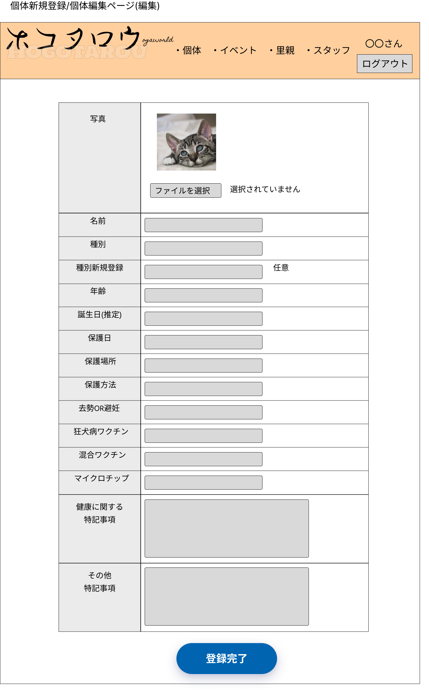

`${mode}` が `new` / `edit`。`<form:form id="animalForm" modelAttribute="animalForm" method="post" enctype="multipart/form-data">`、action は new なら `/animal/new`、edit なら `/animal/${animalId}/edit`。画面は「基本情報」カード（写真・名前・犬猫・品種・新しい品種・性別）と「保護情報・健康情報」カード（それ以外）の2枚。必須の項目にはラベルの後ろに赤字で「（必須）」を付ける。

新規登録で、画面を開いたときに保護頭数が定員に達していれば（F-07 の `capacityFull`）、見出しの下に `<dialog open class="hogo-dialog">` で「保護頭数が定員に達しています。このまま登録することもできます。」と「閉じる」ボタンを出す。登録は止めない。入力エラーで再表示したときは出さない。

|項目|name|タグ・型|必須|チェック|エラーメッセージ|
|---|---|---|:---:|---|---|
|写真|photo | file, accept="image/jpeg,image/png"（下に「JPEG または PNG / 5MB以下」と表示） | | Service: 選ばれていれば保存、空なら変更なし。送信前に Cropper.js が 600×600 の JPEG に作り直す（下の「写真」） | （413 のときの error.jsp の文言）ファイルは 5MB 以下にしてください |
|名前|name | text, maxlength=10 | ○ | `@NotBlank @Size(max=10)` | 名前を入力してください / 名前は10文字以内で入力してください |
|犬猫|species | radio（犬 `DOG` / 猫 `CAT`） | ○ | `@NotNull` | 犬猫を選択してください |
|品種|breedId | select（先頭に「未選択」。`breedList` を「-- 猫 --」「-- 犬 --」の optgroup に分けて全部出す） | | 任意。Service: 指定時は `breedRepository.findById`、無ければ 404。品種の犬猫が個体の犬猫と違えば入力エラー | 犬猫と品種の組み合わせが不正です。 |
|新しい品種|newBreedName|text, maxlength=50||`@Size(max=50)`。入力があれば `breedId` より優先（Service）|品種は50文字以内で入力してください|
|性別|sex | radio（オス `MALE` / メス `FEMALE` / 不明 `UNKNOWN`） | ○ | `@NotNull` | 性別を選択してください |
|誕生日|birthday | date | | `@PastOrPresent` | 未来の日付は指定できません |
|誕生日は推定|isBirthdayEstimated | radio（推定 `true` / 推定ではない `false`。誕生日の右に並べる） | | なし | なし |
|保護日|intakeDate | date | ○ | `@NotNull @PastOrPresent` | 保護日を入力してください / 未来の日付は指定できません |
|保護場所|intakePlace | text, maxlength=50 | ○ | `@NotBlank @Size(max=50)` | 保護場所を入力してください / 保護場所は50文字以内で入力してください |
|保護方法|intakeMethod | text, maxlength=30 | ○ | `@NotBlank @Size(max=30)` | 保護方法を入力してください / 保護方法は30文字以内で入力してください |
|保護状況|status | select（先頭に「未選択」、続けて `statusList` の8種類） | ○ | `@NotNull` | 保護状況を選択してください |
|里親|adopterId | select（先頭に「未選択」、続けて `adopterList`（名前順）） | | 保護状況がトライアル中・譲渡済のときだけ使う。空なら入力エラー。指定時は `findByIdAndOrganizationId` で引き直し、無ければ 404。それ以外の保護状況では里親を外す（null で保存） | このステータスの場合は里親を選択してください。 |
|避妊去勢|neutered | radio（済 `DONE` / 未 `NOT_DONE` / 不明 `UNKNOWN`） | ○ | `@NotNull` | 避妊去勢を選択してください |
|混合ワクチン|comboVaccine | radio（済 `true` / 未 `false`） | ○ | `@NotNull` | 混合ワクチンを選択してください |
|狂犬病ワクチン|rabiesVaccine | radio（済 `true` / 未 `false`）。犬のときだけ表示（JS で切り替え） | 犬は○ | Service: 犬で空なら入力エラー。猫なら `false` で保存 | 犬の場合は狂犬病ワクチンを選択してください。 |
|マイクロチップ番号|microchipNo | text, maxlength=15（画面のラベルは「マイクロチップ」） | | `@Pattern("^$\|^[0-9]{15}$")` | マイクロチップ番号は15桁の数字で入力してください |
|健康に関する特記事項|healthNotes | textarea, maxlength=2000, rows=5 | | `@Size(max=2000)` | 2000文字以内で入力してください |
|その他の特記事項|notes | textarea, maxlength=2000, rows=5 | | `@Size(max=2000)` | 2000文字以内で入力してください |

- `<form:errors path="...">` は各項目の下に出す
- 写真: 編集で現在の写真があればそれを表示し、無いときは「写真をアップロードしてください」の枠を出す。写真を選ぶと Cropper.js で正方形のトリミング枠を出し、送信時に 600×600 の JPEG（`photo.jpg`）に作り直してから送る。写真を選んでいなければそのまま送信する。この変換で、画面から送る写真は 5MB の上限に当たらない（7章）
- 初期値（F-07）: 「誕生日は推定」= 推定、保護状況 = 保護中(譲渡不可)、避妊去勢 = 不明、混合ワクチン・狂犬病ワクチン = 未
- 品種のプルダウンは犬猫のラジオに関係なく全品種を出す。合わない品種を選ぶと、保存時に「犬猫と品種の組み合わせが不正です。」。選択肢に無いときは「新しい品種」に入力する（同じ犬猫・同じ名前があればそれを使い、無ければ `breeds` に登録する。品種は全団体共通）
- 狂犬病ワクチンの行は、犬のラジオにチェックが入っているときだけ表示する（JS の `toggleRabies()`。犬猫のラジオの `onchange` と画面を開いたときに呼ぶ）
- 保護状況・里親・品種のプルダウンは `<select>` + `<c:forEach>` で書き、選択中の値に `selected` を付ける（入力エラーで再表示しても選択が残る）

| 操作 | 遷移先 |
|---|---|
| 登録する（new）| F-08 → S-04 |
| 更新する（edit）| F-10 → S-04 |
| キャンセル | new → S-03、edit → S-04 |

### 3.2 機能（F-05 〜 F-11）

#### F-05 GET /animal（AnimalController#list）
1. `AnimalSearchForm`（`species` `List<Species>`、`statuses` `List<Status>`、`name` `String`。どれも任意）と `search`（検索ボタンの値。任意）を受ける
   - `search` が無く、かつ `statuses` が空のとき（一覧を初めて開いたとき）だけ、`statuses` に `Status.inCare()` を入れる。チェックを全部外して検索したときは全部が表示される
2. `animalService.search(団体ID, form)`
   - → `species` `statuses` が空なら全部に置き換え、`name` が null なら空文字にする
   - → `animalRepository.findByOrganizationIdAndSpeciesInAndStatusInAndNameContainingOrderByIdDesc(organizationId, speciesList, statusList, name)`（名前は部分一致）
3. Model: `animalList`、`resultCount`、`speciesList`、`statusList`（チェックボックスの選択肢）→ animal/list.jsp

#### F-06 GET /animal/{id}（AnimalController#detail）
1. `animalService.findById(id, 団体ID)` → `animalRepository.findByIdAndOrganizationId`、空なら 404
2. `animalService.findEventList(id, 団体ID)` → `eventRepository.findByOrganizationIdAndAnimalIdOrderByEventDateDescEventTimeDesc`
3. Model: `animal`、`eventList` → animal/detail.jsp

#### F-07 GET /animal/new（AnimalController#newForm）
1. 空の `AnimalForm` に初期値を入れる: `isBirthdayEstimated` = true、`status` = `Status.NOT_ADOPTABLE`、`neutered` = `NeuterStatus.UNKNOWN`、`comboVaccine` = false、`rabiesVaccine` = false
2. 選択肢を用意する: `Status.values()`、`breedRepository.findAllByOrderBySpeciesAscNameAsc()`（品種。全団体共通）、`adopterRepository.findByOrganizationIdOrderByNameAsc(団体ID)`（里親。自団体だけ）
3. 保護頭数が定員に達しているかを調べ、Model に `capacityFull` を入れる
   - `isFull(団体ID)`: `topService.countInCare(団体ID) >= topService.findOrganization(団体ID).getCapacity()`（トップページの「満員」と同じ条件）
4. Model: `animalForm`、`mode`="new"、`statusList`、`breedList`、`adopterList`、`capacityFull` → animal/form.jsp

#### F-08 POST /animal/new（AnimalController#create）
1. `@Validated AnimalForm`、`BindingResult` で受ける。入力エラーがあれば、選択肢と `mode`="new" を入れて同じフォームを再表示する（リダイレクトしない）
2. 登録前の保護頭数を覚えておく: `before = topService.countInCare(団体ID)`
3. `animalService.create(form, 団体ID)` で登録する。Service の中の順番:
   - → `new Animal()`。`organization` は `getReferenceById(団体ID)`。`name` `species` `sex` を詰める
   - → `newBreedName` に入力があれば `breedRepository.findBySpeciesAndName(species, newBreedName)` で探し、無ければ `breeds` に登録して個体の品種にする。無ければ `breedId` 指定時に `breedRepository.findById`（無ければ 404）
   - → 品種の `species` が個体の `species` と違えば入力エラー「犬猫と品種の組み合わせが不正です。」
   - → `birthday` `isBirthdayEstimated` `intakeDate` `intakePlace` `intakeMethod` `status` を詰める
   - → 保護状況がトライアル中・譲渡済のとき: `adopterId` が空なら入力エラー「このステータスの場合は里親を選択してください。」。あれば `adopterRepository.findByIdAndOrganizationId` で引き直し（無ければ 404）、里親にする。それ以外の保護状況では `adopter` を null にする
   - → `neutered` `comboVaccine` を詰める。犬で `rabiesVaccine` が空なら入力エラー「犬の場合は狂犬病ワクチンを選択してください。」。猫なら `rabiesVaccine` は false
   - → `microchipNo` `healthNotes` `notes` は `blankToNull` で詰める
   - → 写真が選ばれていれば `savePhoto` で保存し、戻り値を `imagePath` に入れる（チェックがすべて終わってから保存する）
     - `savePhoto`: ファイル名は `UUID.randomUUID()` + 拡張子（種類が PNG なら `.png`、それ以外は `.jpg`）。`uploads/photos/` に保存し、`/photos/ファイル名` を返す。失敗したら 500「写真を保存できませんでした」
   - → `animalRepository.save(animal)`、登録した `Animal` を返す
   - 入力エラーは `AnimalValidationException` で Controller に伝え、Controller が `result.rejectValue` に載せて 1. と同じく再表示する（1.5）

|メッセージ|項目|コード|
|---|---|---|
|犬猫と品種の組み合わせが不正です。|`breedId`|`breed.speciesMismatch`|
|このステータスの場合は里親を選択してください。|`adopterId`|`adopter.required`|
|犬の場合は狂犬病ワクチンを選択してください。|`rabiesVaccine`|`rabiesVaccine.required`|

4. `addCapacityFull(before, 団体ID, redirectAttributes)`: 登録後の保護頭数が `before` より増えていて、かつ `isFull` なら、フラッシュ `capacityFull` = true を渡す（S-04 のメッセージ）。譲渡済など、保護頭数に数えない保護状況で登録したときは出さない
5. フラッシュ「個体新規登録が完了しました」→ `redirect:/animal/{id}`（F-06）

#### F-09 GET /animal/{id}/edit（AnimalController#editForm）
1. `animalService.getEditForm(id, 団体ID)`: `findByIdAndOrganizationId` で取り（空なら 404）、`Animal` の値を `AnimalForm` に詰めて返す（`breedId` `adopterId` は品種・里親があるときだけ。`notes` も詰める）
2. 選択肢は F-07 と同じ。現在の写真を表示するため、`animal` と `imagePath` も Model に入れる
3. Model: `animalForm`、`animalId`、`mode`="edit"、`statusList`、`breedList`、`adopterList`、`animal`、`imagePath` → animal/form.jsp

#### F-10 POST /animal/{id}/edit（AnimalController#update）
1. `@PathVariable id`、`@Validated AnimalForm`、`BindingResult` で受ける。入力エラーがあれば、選択肢と `animalId`・`mode`="edit"・`animal`・`imagePath` を入れて同じフォームを再表示する
2. 更新前の保護頭数を覚えておく: `before = topService.countInCare(団体ID)`
3. `animalService.update(id, 団体ID, form)` で更新する。Service の中の順番:
   - → `findByIdAndOrganizationId(id, 団体ID)`。空なら 404。更新前の `imagePath` を覚えておく
   - → `name` `species` `sex`、品種（F-08 と同じ手順）、`birthday` `isBirthdayEstimated` `intakeDate` `intakePlace` `intakeMethod` `status` を上書き
   - → 里親は F-08 と同じ（トライアル中・譲渡済なら必須で引き直し、それ以外は null にする。トライアル中・譲渡済から戻したときに紐づきが残らないようにする）
   - → `neutered` `comboVaccine`、狂犬病ワクチン（F-08 と同じ）、`microchipNo` `healthNotes` `notes`（`blankToNull`）を上書き
   - → チェックがすべて終わったあとで写真を処理する。写真が選ばれていれば `savePhoto` で保存して `imagePath` を差し替え、古い写真があれば削除する（失敗したら 500「古い写真を削除できませんでした」）
   - → `animalRepository.save(animal)`
   - Controller のエラー処理は F-08 と同じ
4. `addCapacityFull(before, 団体ID, redirectAttributes)`（F-08 と同じ。譲渡済などから保護中に戻して定員以上になったときだけ出す）
5. フラッシュ「個体を編集しました」→ `redirect:/animal/{id}`（F-06）

#### F-11 POST /animal/{id}/delete（AnimalController#delete）
1. `loginUser.getRole()` が `ADMIN` でなければ 403
2. `animalService.delete(id, 団体ID)`: `findByIdAndOrganizationId` で取り（空なら 404）、`animalRepository.delete(animal)`。紐づくイベントは DB の `ON DELETE CASCADE` で一緒に消える
   - → `imagePath` があれば、写真ファイル（`uploads` + `imagePath`）も削除する（失敗したら 500「写真を削除できませんでした」）
3. フラッシュ「個体を削除しました」→ `redirect:/animal`（F-05）

<br>
<a id="chapter4"></a>

## 4. イベント管理

### 4.1 画面（S-07 〜 S-10）

#### S-07 イベント一覧（event/calendar.jsp）

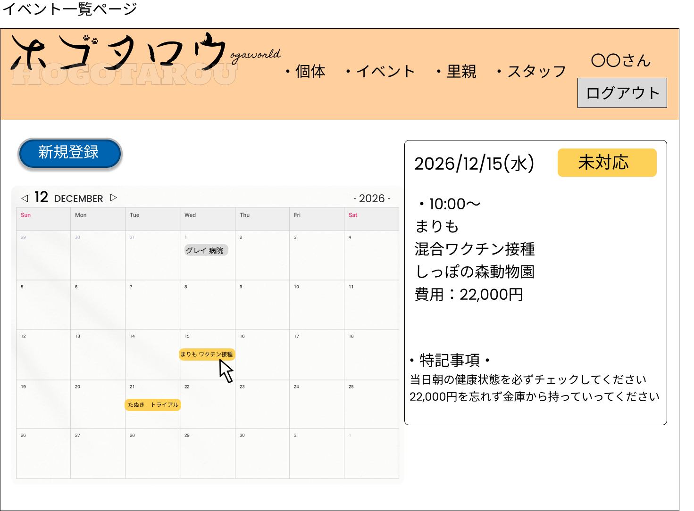

- 見出しは「イベント管理」。月間カレンダーでその月のイベントを表示する。初期表示は今月（日本時間）
- ◁▷で前月・次月に切り替える（`/event?year=&month=`）。表示できる年は 1900〜2100 年。年月の右に「今月を表示」ボタン（`/event`）を置く
- 曜日の見出しは 日〜土。日曜の列は赤系、土曜の列は青系。前月・次月のはみ出したマスは背景を薄くする
- カレンダーの右に概要ペインを置く（画面の幅が 1100px 以下のときはカレンダーの下）。1日に5件以上あるマスは、マスの中で縦スクロールにする
- イベントバーは未対応と対応済で色を分け、表の下に凡例「未対応」「対応済」を出す
- 概要ペインの初期状態は、見出し「イベントを選択」と案内文。バーをクリックすると、JS がサーバー側で作っておいたそのイベントの内容（各マスの `<template>` に `<c:out>` で書いておく）をペインにコピーして表示し、見出しを「{日付}のイベント」にする。「選択を解除」ボタンで初期状態に戻す
- URL に `selectedEventId` が付いているとき（スタンプ操作のあと、トップページのミニカレンダーから来たとき）は、表示後に JS がそのイベントのバーを自動でクリックし、概要ペインを開いた状態にする
- スタンプ欄は、概要ペインに出すイベントごとに `<form:form method="post">` を置く。未対応なら `action` を `/event/{id}/complete`、対応済なら `/event/{id}/uncomplete` にし、hidden の `reopenPane=true` を入れる（保存後にこのカレンダーへ戻って概要ペインを開き直す）。確認メッセージは form の `onsubmit` に書く
- ボランティアにはスタンプ欄を出さず、代わりに対応状況を文字（未対応／対応済）で出す（`<sec:authorize>` で出し分け）
- 「＋ 新規登録」ボタンは `<sec:authorize access="hasAnyRole('ADMIN', 'STAFF')">` で囲む
- フラッシュ（`${message}`）は `alert alert-success`

カレンダー表示項目

|表示項目|内容|備考|
|---|---|---|
|年月|`${calendar.year}年${calendar.month}月`|現在表示中の年月|
|日付|`${d.day}`|月間カレンダー形式|
|イベントバー|時刻`${e.eventTime}`、個体名`${e.animal.name}`、`：`、種別`${e.eventType.name}`、`（未）`／`（済）`|時刻は入っているときだけ1行目に出す|

概要ペイン表示項目

|表示項目|内容|備考|
|---|---|---|
|見出し|個体名`${e.animal.name}`：種別`${e.eventType.name}`|`<h3>`|
|対応状況|未/済|未対応なら空のスタンプ欄と「未対応：クリックで対応済にする」、対応済なら済スタンプと「クリックで未対応に戻す」。ボランティアには文字で「未対応」「対応済」|
|基本|日付、時刻、個体名、イベント種別、場所、費用|時刻・場所・費用は任意。無ければ表示しない。個体名は `/animal/{id}` へのリンク。費用は「{金額} 円」|
|里親|`${e.adopter.name}`|里親が紐づいているときだけ表示|
|特記事項|`${e.notes}`（改行を保って表示）|入っているときだけ表示|
|詳細を見る|`/event/{id}` へのボタン||

|操作|権限|遷移先|
|---|:---:|---|
|新規登録ボタン|S|S-09|
|イベントバークリック|V|概要ペインに表示（画面遷移なし）|
|◁▷|V|S-07（前月・次月の年月つき）|
|今月を表示|V|S-07（年月なし = 今月）|
|選択を解除|V|概要ペインを初期状態に戻す（画面遷移なし）|
|スタンプ欄のクリック（未対応のとき）|S|確認「イベントを完了にしますか？個体の情報は自動では変わりません」→ F-18 → S-07（概要ペインを開いた状態）|
|スタンプ欄のクリック（対応済のとき）|S|確認「イベントを未対応に戻しますか？個体の情報は自動では変わりません」→ F-34 → S-07（概要ペインを開いた状態）|
|個体名リンク|V|S-04|
|詳細を見るボタン|V|S-08|

編集へは詳細画面（S-08）の「編集」から進む。

#### S-08 イベント詳細（event/detail.jsp）

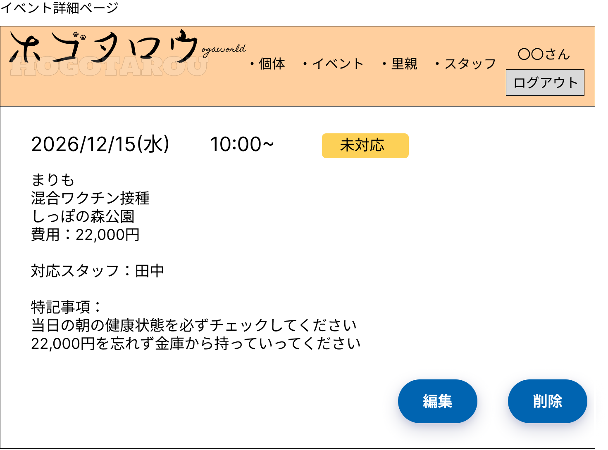

上に「← 一覧へ戻る」（左）と「編集」「削除」（右）を並べ、その下を「基本情報」「対応状況」「特記事項」の3つのカードに分ける。フラッシュ（`${message}`）は `alert alert-success`。

|表示項目|内容|
|---|---|
|基本|「基本情報」カードの表。行の並びは 日付 → 時刻 → 個体名 → イベント種別 → 場所 → 里親 → 対応スタッフ → 費用。時刻・場所・費用は無ければ行を出さない。費用は「{金額} 円」|
|個体|`${event.animal.name}` を `/animal/{id}` へのリンクで|
|里親|`${event.adopter.name}` を `/adopter/{id}` へのリンクで。里親が紐づいているときだけ表示|
|対応スタッフ|行は常に表示する。対応済でスタッフが入っているときだけ `${event.staff.name}` を `/staff/{id}` へのリンクで出す。それ以外は空欄|
|対応状況|「対応状況」カード。S-07 の概要ペインと同じスタンプ欄（ボランティアには文字）|
|特記事項|「特記事項」カード。`<p class="hogo-notes"><c:out value="${event.notes}"/></p>`。空なら「特記事項はありません」|

- スタンプ欄の form には `reopenPane` を入れない（F-18・F-34 のあとは、この詳細画面に戻る）
- 削除の確認は、form の `data-confirm="本当に削除しますか？"` を detail.jsp の `<script>` が読み、`window.confirm()` で出す

|操作|権限|遷移先|
|---|:---:|---|
|スタンプ欄のクリック（未対応のとき）|S|確認 → F-18 → S-08|
|スタンプ欄のクリック（対応済のとき）|S|確認 → F-34 → S-08|
|個体名リンク|V|S-04|
|里親名リンク|V|S-12|
|対応スタッフ名リンク|V|S-16|
|編集ボタン|S|S-10|
|削除ボタン|A|確認「本当に削除しますか？」→ F-19|
|一覧へ戻る|V|S-07（このイベントの年月）|

#### S-09 イベント新規登録・S-10 イベント編集（event/form.jsp 共用）

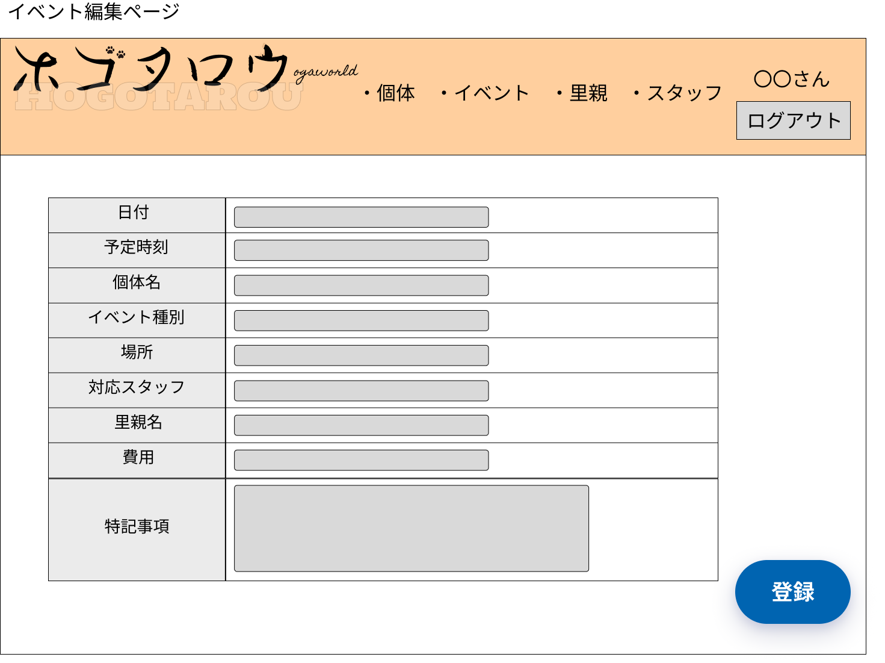

`<form:form modelAttribute="eventForm" action="${submitUrl}" method="post">`、`${mode}` が `new` / `edit`。`submitUrl` は new なら `/event/new`、edit なら `/event/${eventId}/edit`。見出しは「イベント新規登録」/「イベント編集」。カードの見出しは「イベント情報」、その下に「「必須」の項目を入力してください。里親はトライアル開始・譲渡の場合に必須です。」と出す。必須の項目のラベルには「必須」バッジを付ける。

|項目|name|タグ・型|必須|チェック|エラーメッセージ|
|---|---|---|:---:|---|---|
|日付|eventDate|date|○|`@NotNull`|日付を入力してください|
|時刻|eventTime|time||任意|なし|
|個体|animalId|select（`animalList`。先頭に「選択してください」）|○|`@NotNull`。Service: 存在しなければ rejectValue。保護状況が `Status.inCare()` に入っていない個体なら rejectValue（編集で、保存済みのイベントの個体のままなら通す）|個体を選択してください / 個体の指定が不正です / 選択できない個体です|
|イベント種別|eventTypeId|select（`eventTypeList`。先頭に「選択してください」）|○|`@NotNull`。Service: 存在しなければ rejectValue。個体が猫で種別が狂犬病ワクチンなら rejectValue|種別を選択してください / 種別の指定が不正です / 猫には狂犬病ワクチンを登録できません|
|場所|place|text, maxlength=100||`@Size(max=100)`|場所は100文字以内で入力してください|
|里親|adopterId|select（`adopterList`。先頭に「なし」）||種別がトライアル開始・譲渡なら必須（Service）。指定時は `findByIdAndOrganizationId` で引き直し。下に「トライアル開始・譲渡の場合は選択してください。」と補足を出す|トライアル開始・譲渡の場合は里親を選択してください / 里親の指定が不正です|
|費用（円）|cost|number, inputmode=numeric||`Integer`。`@PositiveOrZero`|費用は0以上で入力してください|
|特記事項|notes|textarea, rows=6, maxlength=2000||`@Size(max=2000)`|2000文字以内で入力してください|

- プルダウンの選択肢は `itemValue="id"` `itemLabel="name"`
- 団体ID・対応スタッフ・対応状況は画面から受け取らない。対応スタッフと対応状況は完了（F-18）と未対応に戻す（F-34）のときだけ変わる
- 個体の選択肢は、保護状況が `Status.inCare()` の個体だけ（名前順）。編集のときは、現在の個体がこの4つに入っていなくても選択肢に含める（末尾に足す）
- イベントを登録・編集・完了・未対応に戻す・削除しても、個体の情報は変わらない
- イベント種別は11種類（`sql/schema.sql` の `INSERT INTO event_types`）。種別の `code` で入力チェックするのは、狂犬病ワクチン（`RABIES_VACCINE`。猫には登録できない）と、トライアル開始・譲渡（`TRIAL_START` `ADOPTION`。里親必須）だけ
- アノテーションのチェックでエラーがあるときは、Service のチェックは行わない

| 操作 | 遷移先 |
|---|---|
| 登録する（new）| F-15 → S-07（登録したイベントの年月） |
| 更新する（edit）| F-17 → S-08 |
| キャンセル | new → S-07（今月）、edit → S-08 |

### 4.2 機能（F-12 〜 F-19、F-34）

#### F-12 GET /event（EventController#list）
1. 表示する年月 `year` `month`（Integer。どちらも任意）を受ける。どちらかが未指定、または範囲外（year が 1900〜2100 以外、month が 1〜12 以外）なら今月（日本時間）を表示する
2. `eventService.search(団体ID, year, month)` でカレンダーを組み立てる
   - → 表示期間は「1日を含む週の日曜」〜「末日を含む週の土曜」
   - → `eventRepository.findByOrganizationIdAndEventDateBetweenOrderByEventDateAscEventTimeAsc(organizationId, 開始日, 終了日)`
   - → 取得したイベントを日ごとに振り分け、`EventCalendar` を作って返す。前月・次月は `YearMonth` の `minusMonths(1)` `plusMonths(1)`
3. Model: `calendar` → event/calendar.jsp
- `selectedEventId` は Controller では受け取らない（calendar.jsp の JS が URL から読む）
- F-01（トップページ）も同じ `eventService.search(団体ID, null, null)` で今月のカレンダーを作る

`EventCalendar`（カレンダー1か月分）

|フィールド|型|内容|
|---|---|---|
|year|int|表示中の年|
|month|int|表示中の月|
|prevYear / prevMonth|int|前月の年・月（◁ のリンク用）|
|nextYear / nextMonth|int|次月の年・月（▷ のリンク用）|
|weeks|`List<List<CalendarDay>>`|週のリスト。1週は日曜〜土曜の7日|

`CalendarDay`（カレンダー1マス分）

|フィールド|型|内容|
|---|---|---|
|date|`LocalDate`|日付|
|day|int|日（1〜31）。`getDay()` で返す|
|inMonth|boolean|表示中の月の日なら true|
|eventList|`List<Event>`|その日のイベント（時刻の早い順）|

どちらも `com.example.hogotaro.dto` パッケージに置く（画面に渡すための入れ物。Entityではない）。

#### F-13 GET /event/{id}（EventController#detail）
1. `eventService.findbyId(id, 団体ID)` → `eventRepository.findByIdAndOrganizationId`、空なら 404
2. Model: `event` → event/detail.jsp（「一覧へ戻る」の年月は `event.eventDate` から作る）

#### F-14 GET /event/new（EventController#newForm）
1. 空の `EventForm` を用意する
2. 選択肢を用意する（`setNewModel` にまとめる。F-15 の再表示でも使う）
   - `eventService.findAnimalList(団体ID, null)` → `animalRepository.findByOrganizationIdAndStatusInOrderByNameAsc(organizationId, Status.inCare())`
   - `eventService.findEventTypeList()` → `eventTypeRepository.findAllByOrderById()`
   - `eventService.findAdopterList(団体ID)` → `adopterRepository.findByOrganizationIdOrderByNameAsc`
3. Model: `eventForm`、`animalList`、`eventTypeList`、`adopterList`、`mode`="new" → event/form.jsp

#### F-15 POST /event/new（EventController#create）
1. `@Validated EventForm`、`BindingResult` で受ける。入力エラーがあれば、選択肢と `mode`="new" を入れて同じフォームを再表示する（Service は呼ばない）
2. `eventService.create(form, result, 団体ID)` で登録する。Service の中の順番:
   - → `animalRepository.findByIdAndOrganizationId(animalId, 団体ID)`。空なら `rejectValue("animalId", "invalid", "個体の指定が不正です")`。保護状況が `Status.inCare()` に入っていなければ `rejectValue("animalId", "invalid", "選択できない個体です")`
   - → `eventTypeRepository.findById(eventTypeId)`。空なら `rejectValue("eventTypeId", "invalid", "種別の指定が不正です")`
   - → `adopterId` 指定時は `adopterRepository.findByIdAndOrganizationId`。空なら `rejectValue("adopterId", "invalid", "里親の指定が不正です")`
   - → 種別の `code` が `TRIAL_START` `ADOPTION` で `adopterId` が空なら `rejectValue("adopterId", "required", "トライアル開始・譲渡の場合は里親を選択してください")`
   - → 個体が猫で種別の `code` が `RABIES_VACCINE` なら `rejectValue("eventTypeId", "invalid", "猫には狂犬病ワクチンを登録できません")`
   - → エラーがあれば保存せずに null を返す（Controller が `result.hasErrors()` を見て 1. と同じく再表示）
   - → Form の値を `Event` に詰め替え、`place` `notes` が空なら null。`done` は false、`staff` は null。`organization` は `getReferenceById(団体ID)`
   - → `eventRepository.save(event)`、登録したイベントを返す
3. フラッシュ「イベント新規登録が完了しました」→ `redirect:/event?year={年}&month={月}`（F-12）

#### F-16 GET /event/{id}/edit（EventController#editForm）
1. `eventService.getEditForm(id, 団体ID)`: `findbyId` で取り（空なら 404）、`Event` の値を `EventForm` に詰めて返す（`animalId` `eventTypeId`、里親があれば `adopterId`）
2. 選択肢を用意する（`setEditModel` にまとめる。F-17 の再表示でも使う）。個体は `eventService.findAnimalList(団体ID, 現在の個体ID)` で、現在の個体が `Status.inCare()` に入っていなければ末尾に足す。種別・里親は F-14 と同じ
3. Model: `eventForm`、`eventId`、`animalList`、`eventTypeList`、`adopterList`、`mode`="edit" → event/form.jsp

#### F-17 POST /event/{id}/edit（EventController#update）
1. `@PathVariable id`、`@Validated EventForm`、`BindingResult` で受け、`eventService.update(id, form, result, 団体ID)` を呼ぶ。Service の中の順番:
   - → `findbyId(id, 団体ID)`。空なら 404
   - → `result.hasErrors()`（アノテーションのエラー）なら何もせずに戻る
   - → F-15 と同じチェック。ただし「選択できない個体です」は、保存済みのイベントの個体と同じなら出さない。エラーがあれば保存せずに戻る
   - → `Event` に Form の値（日付・時刻・個体・種別・里親・場所・費用・特記事項）を上書き。`place` `notes` が空なら null。`organization` `done` `staff` は変更しない
   - → `eventRepository.save(event)`
2. 入力エラーがあれば、選択肢と `eventId`・`mode`="edit" を入れて同じフォームを再表示する
3. フラッシュ「イベントを編集しました」→ `redirect:/event/{id}`（F-13）

#### F-18 POST /event/{id}/complete（EventController#complete）
1. `@PathVariable id` と `reopenPane`（boolean。カレンダーの概要ペインの form だけが true を送る）を受ける
2. `eventService.complete(id, 団体ID, loginUser.getStaffId())`
   - → `findbyId(id, 団体ID)`。空なら 404。すでに対応済なら何もせずに返す
   - → 完了にした人を `staffRepository.findByIdAndOrganizationId(staffId, 団体ID)` で引く（空なら 404）
   - → `done` を true、`staff` をその人にして `eventRepository.save(event)`。イベントを返す
3. 押した画面に戻す。フラッシュは設定しない（スタンプの見た目が変わることで結果がわかる）
   - `reopenPane` が true → `redirect:/event?year={年}&month={月}&selectedEventId={id}`（F-12）
   - false → `redirect:/event/{id}`（F-13）

#### F-34 POST /event/{id}/uncomplete（EventController#uncomplete）
1. `@PathVariable id` と `reopenPane` を受ける（F-18 と同じ）
2. `eventService.uncomplete(id, 団体ID)`
   - → `findbyId(id, 団体ID)`。空なら 404。すでに未対応なら何もせずに返す
   - → `done` を false、`staff` を null にして `eventRepository.save(event)`。個体は更新しない
3. 押した画面に戻す（F-18 と同じ）

#### F-19 POST /event/{id}/delete（EventController#delete）
1. `eventService.delete(id, 団体ID)`: `findbyId` で取り（空なら 404）、`eventRepository.delete(event)`。削除したイベントの日付を返す
2. フラッシュ「イベントを削除しました」→ `redirect:/event?year={年}&month={月}`（F-12）

<br>
<a id="chapter5"></a>

## 5. 里親管理

### 5.1 画面（S-11 〜 S-14）

#### S-11 里親一覧（adopter/list.jsp）

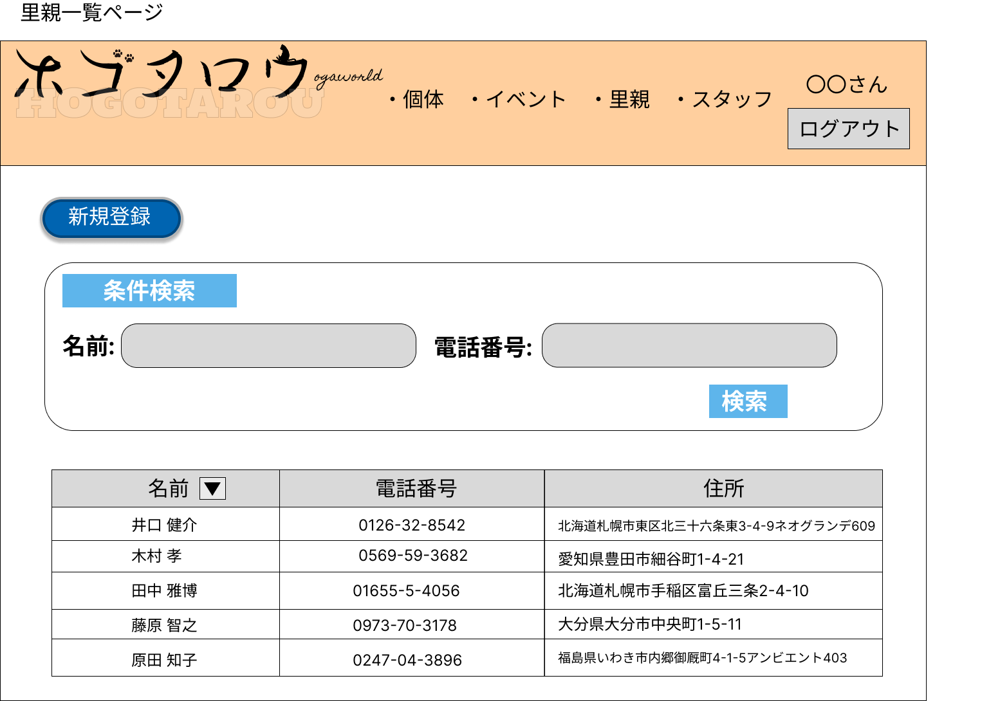

表形式で里親の一覧を表示する。

- 絞り込み：名前、電話番号（`<form:form modelAttribute="searchForm" method="get">`。プレースホルダーは 名前「例：山田 花子」、電話番号「例：090-1234-5678」）
- 「クリア」リンク（条件なしの `/adopter` へ）と「検索」ボタンをこの順に並べる
- 表の上に件数「検索結果 N 件」を出し、右側に新規登録リンク「＋ 新規登録」を置く。0件なら表の代わりに「該当する里親はいません」
- フラッシュ（`${message}`）は `alert alert-warning`

|表示項目|内容|備考|
|---|---|---|
|名前|`<c:out value="${a.name}"/>`| 名前を `/adopter/{id}` へのリンクにする|
|電話番号|`<c:out value="${a.phoneNumber}"/>`||
|住所|`<c:out value="${a.address}"/>`||

|操作|権限|遷移先|
|---|:---:|---|
|新規登録リンク|S|S-13|
|名前クリック|V|S-12|
|検索ボタン|V|S-11（条件つき）|
|クリア|V|S-11（条件なし）|

#### S-12 里親詳細（adopter/detail.jsp）

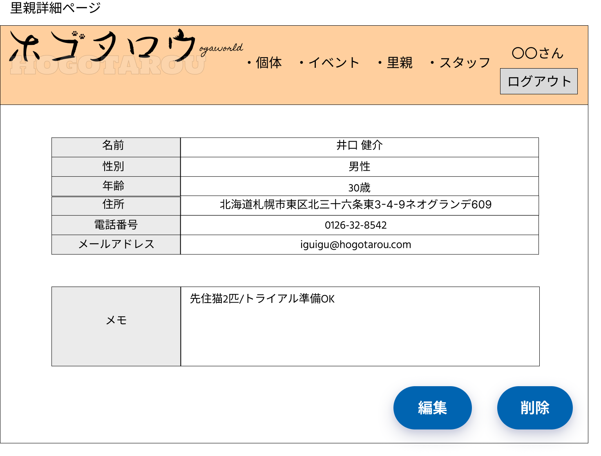

2列レイアウト（PC では左5：右7、スマホでは縦1列）。左に「基本情報」「メモ」、右に「関連する個体」「関連するイベント」のカードを並べる。フラッシュ（`${message}`）は `alert alert-warning`。

|表示項目|内容|
|---|---|
|基本情報|名前・性別・生年月日・年齢・住所・電話番号・メールアドレス。生年月日・年齢は無ければ「不明」（年齢は「○歳」）。住所・電話番号・メールアドレスは無ければ「-」|
|関連する個体|トライアル中・譲渡済の個体（名前・犬猫・保護状況）。見出しに件数。名前を `/animal/{id}` へのリンクにする。並びはトライアル中 → 譲渡済。0件なら「関連する犬猫はいません」|
|関連するイベント|この里親に関連するイベントを日付の降順で（日付・種別・個体名・対応状況）。見出しに件数。日付を `/event/{id}` へのリンクにする。対応状況は済/未のバッジ。0件なら「関連するイベントはありません」|
|メモ|`<p class="hogo-notes"><c:out value="${adopter.notes}"/></p>`。空なら「メモはありません」|

|操作|権限|遷移先|
|---|:---:|---|
|編集リンク|S|S-14|
|削除ボタン|A|確認「本当に削除しますか？」→ F-26 |
|← 一覧へ戻る|V|S-11|

#### S-13 里親新規登録・S-14 里親編集（adopter/form.jsp 共用）

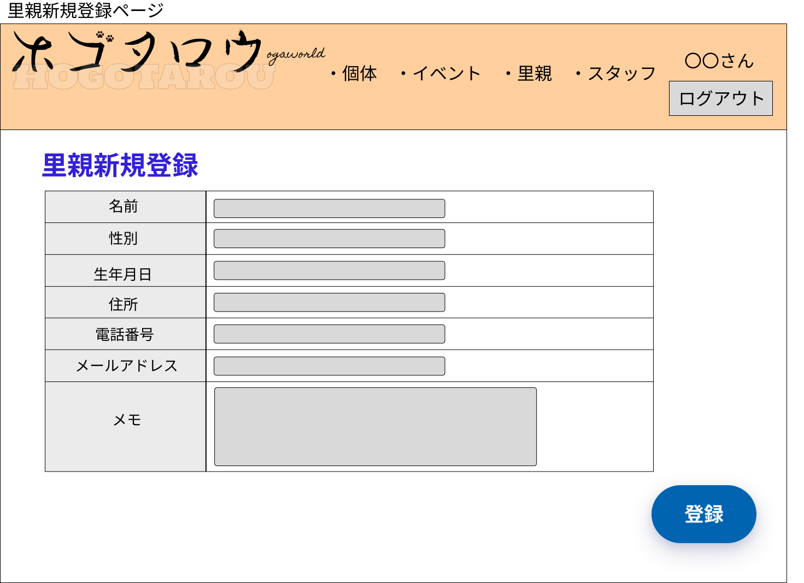

`<form:form modelAttribute="adopterForm" method="post" action="${action}">`、`${mode}` が `new` / `edit`。`action` は new なら `/adopter/new`、edit なら `/adopter/${adopterId}/edit`。キャンセルの戻り先は new なら `/adopter`、edit なら `/adopter/${adopterId}`。見出しは「里親新規登録」/「里親編集」、カードの見出しは「里親情報」。

- 入力エラーがあるときは、フォームの上に「入力内容に誤りがあります。赤枠の項目を確認してください。」を出す（`<spring:hasBindErrors>`）。各項目のエラーは `<form:errors>` で項目の下に出し、入力欄は `cssErrorClass` で赤枠にする
- 必須の項目には、ラベルに「必須」の印を付ける
- 画面上の並びは 名前・性別・生年月日・電話番号・住所・メールアドレス・メモ

|項目|name|タグ・型|必須|チェック|エラーメッセージ|
|---|---|---|:---:|---|---|
|名前|name | text, maxlength=30 | ○ | `@NotBlank @Size(max=30)` | 名前を入力してください / 名前は30文字以内で入力してください |
|性別|gender | radio（男性 / 女性 / その他。`genderList` から作る） | ○ | `@NotNull` | 性別を選択してください |
|生年月日|birthday | date | | `@PastOrPresent` | 未来の日付は指定できません |
|住所|address | text, maxlength=100 |  | `@Size(max=100)` | 住所は100文字以内で入力してください  |
|電話番号|phoneNumber | tel, maxlength=20 | ○ | `@NotBlank @Size(max=20) @Pattern("^$\|^[0-9-]+$")` | 電話番号を入力してください / 電話番号は20文字以内で入力してください / 電話番号は数字とハイフンで入力してください |
|メールアドレス|email | email, maxlength=255 |  | `@Size(max=255) @Email` | メールアドレスは255文字以内で入力してください / メールアドレスの形式が正しくありません |
|メモ|notes | textarea, rows=5 | | `@Size(max=2000)` | 2000文字以内で入力してください |

| 操作 | 遷移先 |
|---|---|
| 登録する（new）| F-23 → S-12 |
| 更新する（edit）| F-25 → S-12 |
| キャンセル | new → S-11、edit → S-12 |

### 5.2 機能（F-20 〜 F-26）

#### F-20 GET /adopter（AdopterController#list）
1. `AdopterSearchForm`（`name` `phoneNumber`。どちらも任意）を受ける
2. `adopterService.search(団体ID, form)`: 名前・電話番号とも部分一致。未入力なら、その条件では絞らない。電話番号はハイフンを無視して比べる
   - → `name` `phoneNumber` が null なら空文字にし、前後の空白を除く。電話番号はハイフンを取り除く
   - → `adopterRepository.search(organizationId, name, phone)`（`@Query`: `select a from Adopter a where a.organization.id = :organizationId and a.name like concat('%', :name, '%') and replace(a.phoneNumber, '-', '') like concat('%', :phone, '%') order by a.id desc`）
3. Model: `adopterList`、`searchForm` → adopter/list.jsp

#### F-21 GET /adopter/{id}（AdopterController#detail）
1. `adopterService.detail(id, 団体ID)` → `adopterRepository.findByIdAndOrganizationId`、空なら 404
2. `adopterService.findAnimalList(id, 団体ID)` → `animalRepository.findByOrganizationIdAndAdopterIdAndStatusInOrderByStatusDesc(organizationId, id, List.of(Status.TRIAL, Status.ADOPTED))`
3. `adopterService.findEventList(id, 団体ID)` → `eventRepository.findByOrganizationIdAndAdopterIdOrderByEventDateDescEventTimeDesc`
4. Model: `adopter`、`animalList`、`eventList` → adopter/detail.jsp

#### F-22 GET /adopter/new（AdopterController#newForm）
1. 空の `AdopterForm` と、性別の選択肢 `Gender.values()` を用意する
2. Model: `adopterForm`、`genderList`、`mode`="new" → adopter/form.jsp

#### F-23 POST /adopter/new（AdopterController#create）
1. `@Validated AdopterForm`、`BindingResult` で受ける。入力エラーがあれば、`genderList` と `mode`="new" を入れて同じフォームを再表示する
2. `adopterService.create(form, 団体ID)`: Form の値を `Adopter` に詰め替え（`address` `email` `notes` は `blankToNull`）、`organization` は `getReferenceById(団体ID)`、`adopterRepository.save`。登録された `id` を返す
3. フラッシュ「里親新規登録が完了しました」→ `redirect:/adopter/{id}`（F-21）

#### F-24 GET /adopter/{id}/edit（AdopterController#editForm）
1. `adopterService.getEditForm(id, 団体ID)`: `detail` で取り（空なら 404）、`Adopter` の値を `AdopterForm` に詰めて返す
2. Model: `adopterForm`、`adopterId`、`genderList`、`mode`="edit" → adopter/form.jsp

#### F-25 POST /adopter/{id}/edit（AdopterController#update）
1. `@PathVariable id`、`@Validated AdopterForm`、`BindingResult` で受ける。入力エラーがあれば、`adopterId`・`genderList`・`mode`="edit" を入れて同じフォームを再表示する
2. `adopterService.update(id, form, 団体ID)`: `detail` で取り（空なら 404）、Form の値を上書き（`address` `email` `notes` は `blankToNull`）、`adopterRepository.save`。`organization` は変更しない
3. フラッシュ「里親を編集しました」→ `redirect:/adopter/{id}`（F-21）

#### F-26 POST /adopter/{id}/delete（AdopterController#delete）
1. `adopterService.delete(id, 団体ID)`: `detail` で取り（空なら 404）、紐づく個体・イベントがあるか確かめる
   - `animalRepository.existsByOrganizationIdAndAdopterId(organizationId, id)`（保護状況に関係なくすべて対象）
   - `eventRepository.existsByOrganizationIdAndAdopterId(organizationId, id)`
   - どちらかが true なら削除せず false を返す → フラッシュ「個体またはイベントに紐づいているため削除できません」→ `redirect:/adopter/{id}`（F-21）
2. 紐づきがなければ `adopterRepository.delete(adopter)` して true を返す → フラッシュ「里親を削除しました」→ `redirect:/adopter`（F-20）

<br>
<a id="chapter6"></a>

## 6. スタッフ管理

### 6.1 画面（S-15 〜 S-18）

#### S-15 スタッフ一覧（staff/list.jsp）

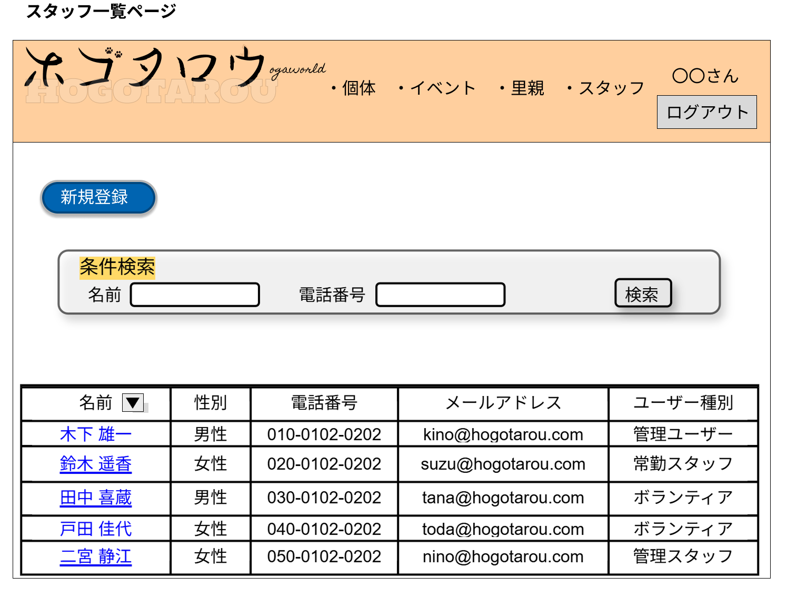

表形式でスタッフの一覧を表示する。

- 絞り込み：名前、電話番号（`<form:form modelAttribute="searchForm" method="get">`。プレースホルダーは 名前「例：山田 太郎」、電話番号「例：090-1234-5678」）
- 「クリア」リンク（条件なしの `/staff` へ）と「検索」ボタンをこの順に並べる
- 表の上に件数「検索結果 N 件」を出し、右側に新規登録リンク「＋ 新規登録」を置く。0件なら表の代わりに「該当するスタッフはいません」
- フラッシュ（`${message}`）は `alert alert-warning`

|表示項目|内容|備考|
|---|---|---|
|名前|`<c:out value="${s.name}"/>`| 名前を `/staff/{id}` へのリンクにする|
|性別|`<c:out value="${s.gender.label}"/>`||
|電話番号|`<c:out value="${s.phoneNumber}"/>`||
|メールアドレス|`<c:out value="${s.email}"/>`|空なら「未登録」|
|ユーザー種別|`<c:out value="${s.userType.name}"/>`||

|操作|権限|遷移先|
|---|:---:|---|
|新規登録リンク|A|S-17|
|名前クリック|V|S-16|
|検索ボタン|V|S-15（条件つき）|
|クリア|V|S-15（条件なし）|

#### S-16 スタッフ詳細（staff/detail.jsp）

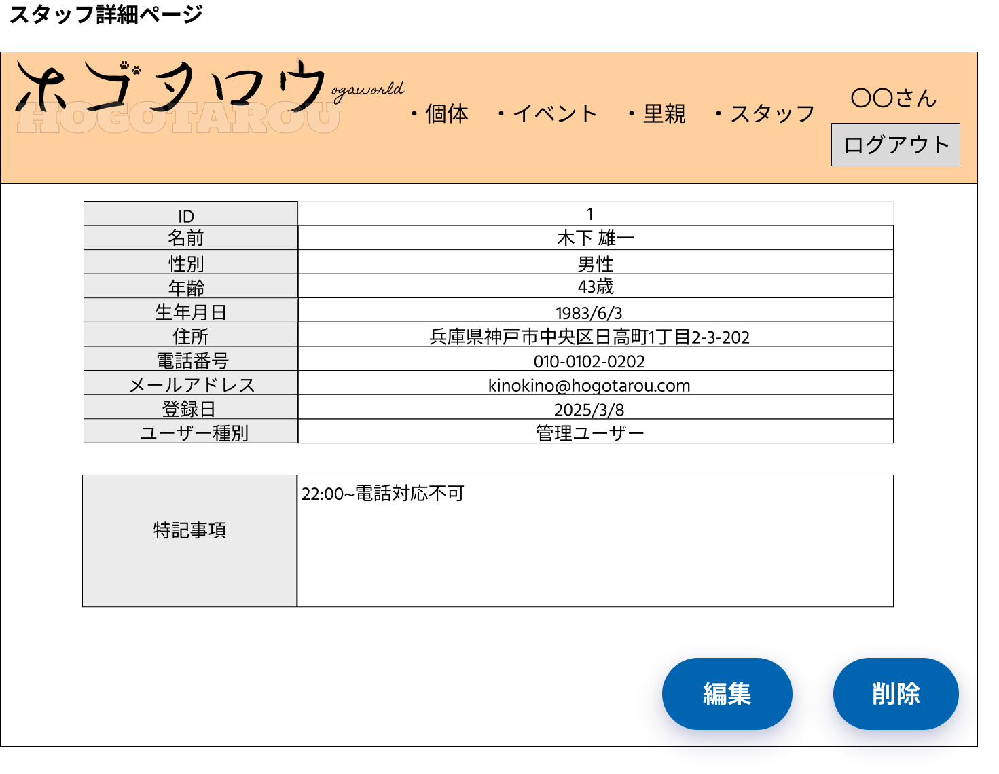

2列レイアウト（PC では左5：右7、スマホでは縦1列）。左に「基本情報」「特記事項」、右に「対応したイベント」のカードを並べる。フラッシュ（`${message}`）は `alert alert-warning`。

|表示項目|内容|
|---|---|
|基本情報|ID（スタッフID）・ログインID・名前・性別・年齢・生年月日・住所・電話番号・メールアドレス・登録日・ユーザー種別。年齢は「○歳」。住所・メールアドレス・登録日は空なら「未入力」|
|対応したイベント|このスタッフが対応した（完了にした）イベントを日付の降順で（日付・種別・個体名）。見出しに件数。日付を `/event/{id}` へのリンクにする。0件なら「イベントはありません」|
|特記事項|`<p class="hogo-notes"><c:out value="${staff.notes}"/></p>`。空なら「未入力」|

|操作|権限|遷移先|
|---|:---:|---|
|編集リンク|A|S-18|
|削除ボタン|A（自分自身の詳細では表示しない）|確認「本当に削除しますか？」→ F-33 |
|← 一覧へ戻る|V|S-15|

- 編集・削除のボタンは `<c:if test="${loginUser.role == 'ADMIN'}">` で囲み、削除はさらに `<c:if test="${staff.id != loginUser.staffId}">` で囲む（1.2）

#### S-17 スタッフ新規登録・S-18 スタッフ編集（staff/form.jsp 共用）

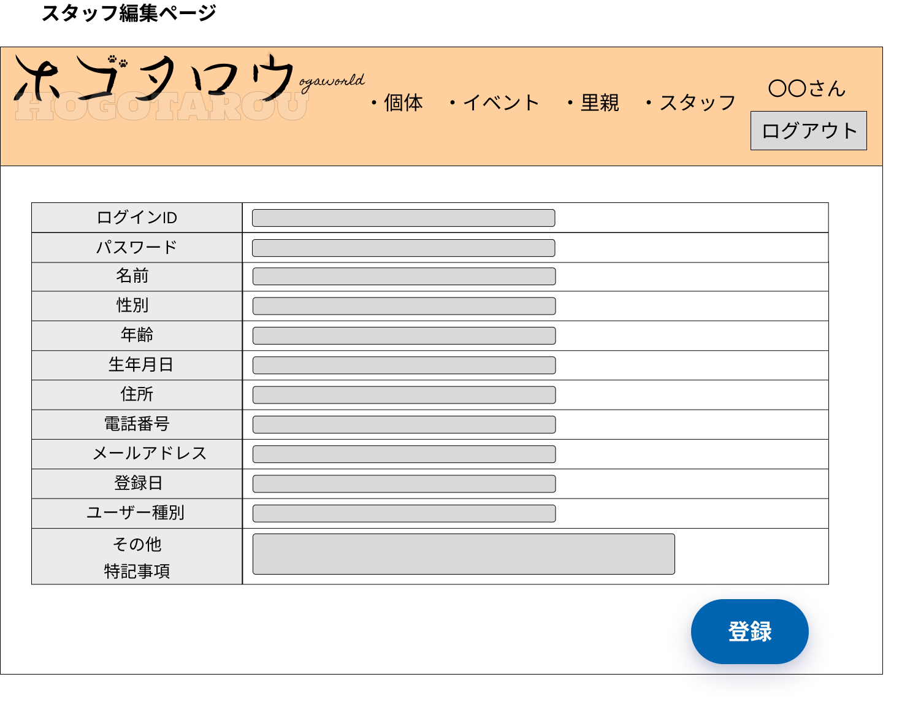

`<form:form modelAttribute="staffForm" method="post">`（`action` は書かず、今開いている URL に POST する）、`${mode}` が `new` / `edit`。見出しは「スタッフ新規登録」/「スタッフ編集」、カードの見出しは「スタッフ情報」。編集画面では、Model の `staff` を使ってログインIDの表示・キャンセルの戻り先・自分自身かどうかの判定をする。

- 各項目のエラーは `<form:errors>` で項目の下に出し、入力欄は `cssErrorClass` で赤枠にする
- 必須の項目には、ラベルに「必須」の印を付ける（パスワードは new だけ）
- 画面上の並びは ログインID・パスワード・名前・性別・生年月日・電話番号・住所・メールアドレス・登録日・ユーザー種別・特記事項

|項目|name|タグ・型|必須|チェック|エラーメッセージ|
|---|---|---|:---:|---|---|
|ログインID|loginId|new: text, maxlength=30 / edit: 表示のみ（`${staff.loginId}`）|new は○|Form: `@Pattern("^$\|^[a-zA-Z0-9]{4,30}$")`。Service（new）: 空・重複。edit では変更しない|ログインIDを入力してください / ログインIDは半角英数字4〜30文字で入力してください / 既に登録済みのログインIDです|
|パスワード|password|password, maxlength=72。edit では下に「変更する場合だけ入力してください」|new は○（edit は任意）|Form: `@Pattern("^$\|^[!-~]{8,72}$")`（半角の英数字・記号だけ。BCrypt の上限が72バイトのため）。Service: new は空不可、edit は空なら変更なし|パスワードを入力してください / パスワードは半角の英数字・記号8〜72文字で入力してください|
|名前|name|text, maxlength=30|○|`@NotBlank @Size(max=30)`|名前を入力してください / 名前は30文字以内で入力してください|
|性別|gender|radio（男性/女性/その他。`genderList` から作る）|○|`@NotNull`|性別を選択してください|
|生年月日|birthday|date|○|`@NotNull @Past`|生年月日を入力してください / 過去の日付を指定してください|
|住所|address|text, maxlength=100||`@Size(max=100)`|住所は100文字以内で入力してください|
|電話番号|phoneNumber|tel, maxlength=20|○|`@NotBlank @Size(max=20) @Pattern("^$\|^[0-9-]+$")`|電話番号を入力してください / 電話番号は20文字以内で入力してください / 電話番号は数字とハイフンで入力してください|
|メールアドレス|email|email, maxlength=255||`@Size(max=255) @Email`|メールアドレスは255文字以内で入力してください / メールアドレスの形式が正しくありません|
|登録日|joinedDate|date。下に「団体にスタッフとして登録した日」||`@PastOrPresent`|未来の日付は指定できません|
|ユーザー種別|userTypeId|select（先頭に「選択してください」、続けて `userTypeList`）|○|`@NotNull`。Service: 存在しなければ rejectValue。edit で自分自身のユーザー種別を変えていたら rejectValue|ユーザー種別を選択してください / ユーザー種別の指定が不正です / 自分自身のユーザー種別は変更できません|
|特記事項|notes|textarea, rows=4, maxlength=2000||`@Size(max=2000)`|2000文字以内で入力してください|

- 団体ID・登録日時・更新日時は画面から受け取らない。登録日（`joinedDate`）は画面から入力する
- `address` `email` `notes` が空なら `null` で保存する
- 自分自身の編集画面では、ユーザー種別のプルダウンの下に赤字で「自分自身のユーザー種別は変更できません」と出す（プルダウン自体は `disabled` にせず、変えて送られたら Service がエラーにする）
- ユーザー種別の変更は、そのスタッフが次にログインしたときから URL の権限に反映される（ロールはログイン時にセッションに入るため）

|操作|遷移先|
|---|---|
|登録（new）|F-30 → S-16|
|更新（edit）|F-32 → S-16|
|キャンセル|new → S-15、edit → S-16|

### 6.2 機能（F-27 〜 F-33）

#### F-27 GET /staff（StaffController#list）
1. `StaffSearchForm`（`name` `phoneNumber`。どちらも任意）を受ける
2. `staffService.search(団体ID, form)`: F-20（里親）と同じ。`staffRepository.search(organizationId, name, phone)`（`@Query`: `select s from Staff s where s.organization.id = :organizationId and s.name like concat('%', :name, '%') and replace(s.phoneNumber, '-', '') like concat('%', :phone, '%') order by s.id desc`）
3. Model: `staffList`、`searchForm` → staff/list.jsp

#### F-28 GET /staff/{id}（StaffController#detail）
1. `staffService.find(id, 団体ID)` → `staffRepository.findByIdAndOrganizationId`、空なら 404
2. `staffService.findEventList(id, 団体ID)` → `eventRepository.findByOrganizationIdAndStaffIdOrderByEventDateDescEventTimeDesc`
3. Model: `staff`、`eventList` → staff/detail.jsp

#### F-29 GET /staff/new（StaffController#newForm）
1. 空の `StaffForm` と、選択肢（`staffService.findUserTypes()` → `userTypeRepository.findAllByOrderById()`、`Gender.values()`）を用意する
2. Model: `staffForm`、`mode`="new"、`userTypeList`、`genderList` → staff/form.jsp

#### F-30 POST /staff/new（StaffController#create）
1. `@Validated StaffForm`、`BindingResult` で受ける。入力エラーがあれば、選択肢と `mode`="new" を入れて同じフォームを再表示する
2. `staffService.create(form, result, 団体ID)`。Service の中の順番:
   - → `loginId` が空なら `rejectValue("loginId", "required", "ログインIDを入力してください")`。`staffRepository.existsByLoginId(loginId)` が true なら `rejectValue("loginId", "duplicate", "既に登録済みのログインIDです")`（ログインIDは全団体で一意なので、団体を条件に入れない）
   - → `password` が空なら `rejectValue("password", "required", "パスワードを入力してください")`
   - → `userTypeRepository.findById(userTypeId)`。空なら `rejectValue("userTypeId", "invalid", "ユーザー種別の指定が不正です")`
   - → エラーがあれば保存せずに null を返す（Controller が `result.hasErrors()` を見て 1. と同じく再表示）
   - → Form の値を `Staff` に詰め替え（`address` `email` `notes` は `blankToNull`）、`passwordHash` に `passwordEncoder.encode(password)`、`organization` は `getReferenceById(団体ID)`
   - → `staffRepository.save(staff)`、登録された `id` を返す
3. フラッシュ「スタッフ新規登録が完了しました」→ `redirect:/staff/{id}`（F-28）

#### F-31 GET /staff/{id}/edit（StaffController#editForm）
1. `staffService.find(id, 団体ID)`（空なら 404）で取り、`staffService.toForm(staff)` で `StaffForm` に詰める（`password` は空のまま。`loginId` は Form に入れず、Model の `staff` から表示する）
2. 選択肢は F-29 と同じ
3. Model: `staffForm`、`mode`="edit"、`staff`、`userTypeList`、`genderList` → staff/form.jsp

#### F-32 POST /staff/{id}/edit（StaffController#update）
1. `@PathVariable id`、`@Validated StaffForm`、`BindingResult` で受ける。入力エラーがあれば、`staff`（`find` で取り直す）・選択肢・`mode`="edit" を入れて同じフォームを再表示する
2. `staffService.update(id, form, result, 団体ID, loginUser.getStaffId())`。Service の中の順番:
   - → `find(id, 団体ID)`。空なら 404
   - → `userTypeRepository.findById(userTypeId)`。空なら `rejectValue("userTypeId", "invalid", "ユーザー種別の指定が不正です")`
   - → `id` がログイン中のスタッフIDと同じ（自分自身の編集）で、かつ `userTypeId` が現在のユーザー種別と違えば `rejectValue("userTypeId", "self", "自分自身のユーザー種別は変更できません")`
   - → エラーがあれば保存せずに戻る（Controller が `result.hasErrors()` を見て 1. と同じく再表示）
   - → `Staff` に Form の値を上書き（`userType` も反映。`address` `email` `notes` は `blankToNull`）。`password` が空でなければ `passwordEncoder.encode(password)` で `passwordHash` を更新する。`loginId` `organization` は変更しない
   - → `staffRepository.save(staff)`
3. フラッシュ「スタッフを編集しました」→ `redirect:/staff/{id}`（F-28）

#### F-33 POST /staff/{id}/delete（StaffController#delete）
1. `staffService.delete(id, 団体ID, loginUser.getStaffId())`: `find` で取り（空なら 404）、`id` がログイン中のスタッフIDと同じなら削除せず false を返す → フラッシュ「自分自身は削除できません」→ `redirect:/staff/{id}`（F-28）
2. 自分自身でなければ `staffRepository.delete(staff)` して true を返す（このスタッフが完了にしたイベントは、対応スタッフが空になる。`ON DELETE SET NULL`）→ フラッシュ「スタッフを削除しました」→ `redirect:/staff`（F-27）

<br>
<a id="chapter7"></a>

## 7. エラー

### 7.1 画面（S-19）

#### S-19 エラー（error.jsp）

カンプは無し。見出し「エラー」、カード（見出し「エラー ${status}」）にメッセージ、その下に「トップページへ」ボタン（`/` へのリンク）だけを表示する。ログイン前のエラーでは、ヘッダーはロゴだけの帯になる。

Java のエラー処理クラスは書かない。application.properties に `spring.web.error.whitelabel.enabled=false` を書き、Spring Boot が 400 / 403 / 404 / 413 / 500 などで `jsp/error.jsp` を表示する。`${status}` で文言を分ける。

|`${status}`|文言|
|:---:|---|
|400|送信された内容に誤りがあります。画面を開き直してから、もう一度操作してください|
|403|この操作を行う権限がありません|
|404|指定されたデータは存在しません|
|413|ファイルは 5MB 以下にしてください|
|その他|システムエラーが発生しました。時間を置いて再度お試しください|

- 404 は Service が `throw new ResponseStatusException(HttpStatus.NOT_FOUND)`（他団体の id も 404）
- 403 は Spring Security（権限なし、CSRF トークンなし）。個体の削除は Controller でも 403 を投げる（1.2）
- 400 は、送られた値の形がおかしいとき（普通に画面を使っていれば起きない）
- 500 は想定外のエラー。写真の保存・削除に失敗したときは `AnimalService` が `ResponseStatusException(HttpStatus.INTERNAL_SERVER_ERROR, ...)` を投げる
- 写真の上限は application.properties の `spring.servlet.multipart.max-file-size=5MB`（`max-request-size` は `6MB`）。個体フォームは送信前に Cropper.js で写真を 600×600 の JPEG に作り直して送るので、画面から普通に送る限り上限には当たらない。Cropper.js を通らずに 5MB を超えるファイルが届いたときは、Tomcat が接続を切るため、ブラウザには error.jsp ではなく「接続がリセットされました」の画面が出る（基本設計8章）

<br>
<a id="chapter8"></a>

## 8. 付録（DDL、初期データ、状態遷移図）

- 8.1 と 8.2 の SQL は、実物の `sql/schema.sql` `sql/data.sql` をそのまま載せている。
- テーブルは `sql/schema.sql` で作る。アプリは Hibernate にテーブルを作らせない（application.properties の `spring.jpa.hibernate.ddl-auto=none`）。
- 流すのは `schema.sql` → `data.sql` の順。

### 8.1 DDL（sql/schema.sql）

- 流し方は `mysql -u root -p --default-character-set=utf8mb4 < sql/schema.sql`。
- テーブルは、参照される側から先に作る（団体 → マスタ（ユーザー種別・イベント種別・品種） → スタッフ → 里親 → 個体 → イベント）。列の定義は基本設計4章のとおり。
- 先頭の `DROP DATABASE` は、開発中に作り直しやすいように入れたもの。実行すると登録済みのデータはすべて消える。
- マスタ（`user_types`・`event_types`）の INSERT も schema.sql の最後に入っている（プログラムが `code` で参照するので、テーブルと一緒に作る）。
- Entity との対応: フィールド名を snake_case にした列に自動で対応する。enum の列（`species` `sex` `gender` `status` `neutered`）は `@Enumerated(EnumType.STRING)` で定数名を保存する。`created_at` `updated_at` は `insertable = false, updatable = false` で、値は MySQL が入れる。

```sql
-- ホゴタロウ DDL（基本設計 4 章）。mysql -u root -p --default-character-set=utf8mb4 < sql/schema.sql
-- このファイルは「DB を丸ごと作り直す」スクリプト。流すたびに hogotaro の中身は全部消える（開発用）。
-- 列を変えたら、このファイル → data.sql の順に流し直す。
-- 下の方にマスタ（user_types・event_types）の INSERT も入っている。マスタはプログラムが code で参照するので、テーブルと一緒に作る。
DROP DATABASE IF EXISTS hogotaro;
CREATE DATABASE hogotaro CHARACTER SET utf8mb4 COLLATE utf8mb4_unicode_ci;
USE hogotaro;

CREATE TABLE organizations (
  id            INT AUTO_INCREMENT PRIMARY KEY,
  name          VARCHAR(50)  NOT NULL,
  address       VARCHAR(100) NOT NULL,
  phone_number  VARCHAR(20),
  email         VARCHAR(255),
  capacity      INT NOT NULL,
  notes         TEXT                     -- 代表者名などもここに書く（代表者の列は作らない。決定 2-16）
);

CREATE TABLE user_types (
  id    INT AUTO_INCREMENT PRIMARY KEY,
  code  VARCHAR(20) NOT NULL UNIQUE,    -- ADMIN / STAFF / VOLUNTEER。Spring Security のロール名になる
  name  VARCHAR(20) NOT NULL
);

CREATE TABLE event_types (
  id    INT AUTO_INCREMENT PRIMARY KEY,
  code  VARCHAR(20) NOT NULL UNIQUE,    -- プログラムが見るのは RABIES_VACCINE / TRIAL_START / ADOPTION の 3 つだけ（入力チェック用）
  name  VARCHAR(20) NOT NULL
);

CREATE TABLE breeds (
  id       INT AUTO_INCREMENT PRIMARY KEY,
  species  VARCHAR(20) NOT NULL,
  name     VARCHAR(50) NOT NULL,
  UNIQUE KEY uk_breeds (species, name)
);

CREATE TABLE staff (
  id               INT AUTO_INCREMENT PRIMARY KEY,
  organization_id  INT NOT NULL,
  login_id         VARCHAR(30)  NOT NULL UNIQUE,
  password_hash    VARCHAR(255) NOT NULL,
  user_type_id     INT NOT NULL,
  name             VARCHAR(30)  NOT NULL,
  gender           VARCHAR(20)  NOT NULL,
  birthday         DATE NOT NULL,
  joined_date      DATE,
  address          VARCHAR(100),
  phone_number     VARCHAR(20)  NOT NULL,
  email            VARCHAR(255),
  notes            TEXT,
  created_at       TIMESTAMP NOT NULL DEFAULT CURRENT_TIMESTAMP,
  updated_at       TIMESTAMP NOT NULL DEFAULT CURRENT_TIMESTAMP ON UPDATE CURRENT_TIMESTAMP,
  FOREIGN KEY (organization_id) REFERENCES organizations(id),
  FOREIGN KEY (user_type_id)    REFERENCES user_types(id)
);

CREATE TABLE adopters (
  id               INT AUTO_INCREMENT PRIMARY KEY,
  organization_id  INT NOT NULL,
  name             VARCHAR(30)  NOT NULL,
  gender           VARCHAR(20)  NOT NULL,
  birthday         DATE,
  address          VARCHAR(100),
  phone_number     VARCHAR(20)  NOT NULL,
  email            VARCHAR(255),
  notes            TEXT,
  created_at       TIMESTAMP NOT NULL DEFAULT CURRENT_TIMESTAMP,
  updated_at       TIMESTAMP NOT NULL DEFAULT CURRENT_TIMESTAMP ON UPDATE CURRENT_TIMESTAMP,
  FOREIGN KEY (organization_id) REFERENCES organizations(id)
);

CREATE TABLE animals (
  id                     INT AUTO_INCREMENT PRIMARY KEY,
  organization_id        INT NOT NULL,
  name                   VARCHAR(10) NOT NULL,
  species                VARCHAR(20) NOT NULL,
  sex                    VARCHAR(20) NOT NULL,
  breed_id               INT,
  birthday               DATE,
  is_birthday_estimated  BOOLEAN NOT NULL DEFAULT TRUE,
  intake_date            DATE NOT NULL,
  intake_place           VARCHAR(50) NOT NULL,
  intake_method          VARCHAR(30) NOT NULL,
  status                 VARCHAR(20) NOT NULL DEFAULT 'NOT_ADOPTABLE',
  adopter_id             INT,
  neutered               VARCHAR(20) NOT NULL DEFAULT 'UNKNOWN',   -- 旧 is_neutered BOOLEAN。DONE（済）/ NOT_DONE（未）/ UNKNOWN（不明）
  combo_vaccine          BOOLEAN NOT NULL DEFAULT FALSE,
  rabies_vaccine         BOOLEAN NOT NULL DEFAULT FALSE,           -- 猫は常に FALSE（画面に出さない。決定 2-5）
  microchip_no           VARCHAR(15),
  health_notes           TEXT,
  notes                  TEXT,
  image_path             VARCHAR(255),
  created_at             TIMESTAMP NOT NULL DEFAULT CURRENT_TIMESTAMP,
  updated_at             TIMESTAMP NOT NULL DEFAULT CURRENT_TIMESTAMP ON UPDATE CURRENT_TIMESTAMP,
  FOREIGN KEY (organization_id) REFERENCES organizations(id),
  FOREIGN KEY (breed_id)        REFERENCES breeds(id)   ON DELETE SET NULL,
  FOREIGN KEY (adopter_id)      REFERENCES adopters(id)
);

CREATE TABLE events (
  id               INT AUTO_INCREMENT PRIMARY KEY,
  organization_id  INT NOT NULL,
  event_type_id    INT NOT NULL,
  animal_id        INT NOT NULL,
  adopter_id       INT,
  staff_id         INT,                  -- 対応スタッフ = 完了にした人。未対応のあいだは NULL
  event_date       DATE NOT NULL,
  event_time       TIME,
  place            VARCHAR(100),
  done             BOOLEAN NOT NULL DEFAULT FALSE,
  cost             INT,
  notes            TEXT,
  created_at       TIMESTAMP NOT NULL DEFAULT CURRENT_TIMESTAMP,
  updated_at       TIMESTAMP NOT NULL DEFAULT CURRENT_TIMESTAMP ON UPDATE CURRENT_TIMESTAMP,
  FOREIGN KEY (organization_id) REFERENCES organizations(id),
  FOREIGN KEY (event_type_id)   REFERENCES event_types(id),
  FOREIGN KEY (animal_id)       REFERENCES animals(id)  ON DELETE CASCADE,   -- 個体を消すとイベントも消える
  FOREIGN KEY (adopter_id)      REFERENCES adopters(id),
  FOREIGN KEY (staff_id)        REFERENCES staff(id)    ON DELETE SET NULL   -- スタッフを消すと対応スタッフが空になる
);

-- ===== マスタ（全団体共通） =====
-- id を明示しているのは、data.sql のデモデータが id で参照しているため。プログラムは id ではなく code で探す。

INSERT INTO user_types (id, code, name) VALUES
  (1, 'ADMIN',     '管理ユーザー'),
  (2, 'STAFF',     '常勤スタッフ'),
  (3, 'VOLUNTEER', 'ボランティア');

-- 完了しても個体は自動で更新しない（決定 2-18）。code は入力チェックだけに使う
INSERT INTO event_types (id, code, name) VALUES
  (1,  'HOSPITAL_VISIT',     '通院'),
  (2,  'HOSPITAL_ADMISSION', '入院'),
  (3,  'HOSPITAL_DISCHARGE', '退院'),
  (4,  'NEUTERING',          '避妊去勢手術'),
  (5,  'COMBO_VACCINE',      '混合ワクチン'),
  (6,  'RABIES_VACCINE',     '狂犬病ワクチン'),   -- 猫には登録できない（決定 2-5）
  (7,  'MICROCHIP',          'マイクロチップ装着'),
  (8,  'TRIAL_START',        'トライアル開始'),   -- 里親必須
  (9,  'TRIAL_RETURN',       'トライアル返却'),
  (10, 'ADOPTION',           '譲渡'),             -- 里親必須
  (11, 'OTHER',              'その他');
```

### 8.2 初期データ（sql/data.sql）

`schema.sql` の後に実行する（`mysql -u root -p --default-character-set=utf8mb4 < sql/data.sql`）。品種と、動作確認用のデモデータが入る。

|データ|件数|内容|
|---|:---:|---|
|ユーザー種別|3行|schema.sql に入っている|
|イベント種別|11行|schema.sql に入っている|
|品種|12行（犬6・猫6）|全団体共通の初期値。個体フォームの「新しい品種」から画面でも増やせる|
|団体|2つ|他団体のデータが見えないことを確かめるため|
|スタッフ|6人|団体1・団体2に、管理ユーザー・常勤スタッフ・ボランティアを1人ずつ。パスワードは全員 `pass1234`|
|里親|3人|団体1に2人、団体2に1人|
|個体|7頭|団体1に6頭、団体2に1頭。入院中（ハナ）と返還（クロ）を含む|
|イベント|6件|日付は `CURDATE()` からの相対値。対応済は1件だけ|

ログインID

|団体|管理ユーザー|常勤スタッフ|ボランティア|
|---|---|---|---|
|1（わんにゃんの家）|admin1|staff1|vol1|
|2（みなと保護猫クラブ）|admin2|staff2|vol2|

```sql
-- デモデータ。schema.sql（テーブルとマスタ）を流したあとに流す。mysql -u root -p --default-character-set=utf8mb4 < sql/data.sql
-- 全アカウントのパスワードは pass1234（BCrypt 済み）。
USE hogotaro;

-- 品種の初期値（全団体共通）。個体フォームの「新しい品種」から画面でも増やせる
INSERT INTO breeds (species, name) VALUES
  ('DOG', '雑種'), ('DOG', '柴犬'), ('DOG', 'トイプードル'), ('DOG', 'チワワ'), ('DOG', 'ミニチュアダックスフンド'), ('DOG', '甲斐犬'),
  ('CAT', '雑種'), ('CAT', 'アメリカンショートヘア'), ('CAT', 'スコティッシュフォールド'), ('CAT', 'ノルウェージャンフォレストキャット'), ('CAT', 'マンチカン'), ('CAT', 'ロシアンブルー');

-- 団体は運営が SQL で登録する（登録画面は作らない。基本設計 8 章「団体の追加手順」）
INSERT INTO organizations (id, name, address, phone_number, email, capacity, notes) VALUES
  (1, 'わんにゃんの家', '東京都新宿区1-1-1', '03-0000-0001', 'info@wannyan.example', 30, '代表: 山田 太郎'),
  (2, 'みなと保護猫クラブ', '神奈川県横浜市2-2-2', '045-000-0002', 'info@minato.example', 15, NULL);

-- ログイン ID: admin1 / staff1 / vol1（団体 1）、admin2 / staff2 / vol2（団体 2）。パスワードは全員 pass1234
-- password_hash は BCryptPasswordEncoder.encode("pass1234") の結果。{bcrypt} は付けない（SecurityConfig が BCryptPasswordEncoder だから）
-- user_type_id は 1 = ADMIN、2 = STAFF、3 = VOLUNTEER（schema.sql のマスタ）
INSERT INTO staff (organization_id, login_id, password_hash, user_type_id, name, gender, birthday, joined_date, phone_number, email) VALUES
  (1, 'admin1', '$2b$10$9yRU3BKtyFtcmegXvhFcieVJqKk30fmk8fvqc...rDyT.lmJemrxi', 1, '山田 太郎', 'MALE',   '1980-04-01', '2020-04-01', '090-0000-0001', 'admin1@wannyan.example'),
  (1, 'staff1', '$2b$10$9yRU3BKtyFtcmegXvhFcieVJqKk30fmk8fvqc...rDyT.lmJemrxi', 2, '佐藤 花子', 'FEMALE', '1990-05-02', '2022-04-01', '090-0000-0002', 'staff1@wannyan.example'),
  (1, 'vol1',   '$2b$10$9yRU3BKtyFtcmegXvhFcieVJqKk30fmk8fvqc...rDyT.lmJemrxi', 3, '鈴木 一朗', 'MALE',   '2000-06-03', '2024-04-01', '090-0000-0003', NULL),
  (2, 'admin2', '$2b$10$9yRU3BKtyFtcmegXvhFcieVJqKk30fmk8fvqc...rDyT.lmJemrxi', 1, '高橋 次郎', 'MALE',   '1975-07-04', '2019-04-01', '090-0000-0004', 'admin2@minato.example'),
  (2, 'staff2', '$2b$10$9yRU3BKtyFtcmegXvhFcieVJqKk30fmk8fvqc...rDyT.lmJemrxi', 2, '田中 美咲', 'FEMALE', '1995-08-05', '2023-04-01', '090-0000-0005', NULL),
  (2, 'vol2',   '$2b$10$9yRU3BKtyFtcmegXvhFcieVJqKk30fmk8fvqc...rDyT.lmJemrxi', 3, '伊藤 健',   'OTHER',  '2001-09-06', '2025-04-01', '090-0000-0006', NULL);

INSERT INTO adopters (organization_id, name, gender, birthday, address, phone_number, email, notes) VALUES
  (1, '中村 恵子', 'FEMALE', '1985-01-15', '東京都杉並区3-3-3', '080-1111-0001', 'nakamura@example.com', '一戸建て。先住猫1匹。日中在宅'),
  (1, '小林 大輔', 'MALE',   '1992-11-20', '東京都練馬区4-4-4', '080-1111-0002', NULL, 'マンション（ペット可）。子ども2人'),
  (2, '渡辺 さくら', 'FEMALE', '1988-03-30', '神奈川県川崎市5-5-5', '080-2222-0001', 'watanabe@example.com', NULL);

-- neutered は DONE（済）/ NOT_DONE（未）/ UNKNOWN（不明）。猫の rabies_vaccine は常に FALSE
INSERT INTO animals (organization_id, name, species, sex, breed_id, birthday, is_birthday_estimated, intake_date, intake_place, intake_method, status, adopter_id, neutered, combo_vaccine, rabies_vaccine, microchip_no, health_notes, notes) VALUES
  (1, 'ファイア', 'CAT', 'MALE',   10, '2018-05-01', TRUE,  '2025-09-01', '新宿区役所前',   '保健所から引き取り', 'NOT_ADOPTABLE', NULL, 'DONE',     TRUE,  FALSE, NULL, '右目に軽い結膜炎。点眼中', '人懐こい。子どもが苦手'),
  (1, 'アクア',   'CAT', 'FEMALE', 7,  '2022-03-15', TRUE,  '2025-08-20', '高田馬場駅周辺', '迷子',               'TRIAL',         1,    'DONE',     TRUE,  FALSE, NULL, NULL, 'トライアル中（中村さん宅）'),
  (1, 'ポチ',     'DOG', 'MALE',   2,  '2020-01-10', FALSE, '2025-07-05', '中野区',         '飼い主放棄',         'ADOPTABLE',     NULL, 'NOT_DONE', TRUE,  TRUE,  '392140000000001', NULL, '散歩が大好き'),
  (1, 'モモ',     'DOG', 'FEMALE', 1,  '2015-06-20', TRUE,  '2024-12-01', '練馬区',         '保健所から引き取り', 'ADOPTED',       2,    'DONE',     TRUE,  TRUE,  NULL, '高齢。関節に注意', '2025-06 に小林さん宅へ譲渡'),
  (2, 'レオ',     'CAT', 'MALE',   8,  '2021-09-09', TRUE,  '2025-09-10', '横浜駅西口',     '迷子',               'NOT_ADOPTABLE', NULL, 'UNKNOWN',  FALSE, FALSE, NULL, NULL, NULL),
  -- 以下 2 頭は絞り込みの確認用（id 6, 7）。ハナは入院中（保護頭数に入る）、クロは返還済（初期表示では出ない）
  (1, 'ハナ',     'DOG', 'FEMALE', 1,  '2019-02-14', TRUE,  '2025-08-01', '杉並区',         '保健所から引き取り', 'HOSPITALIZED',  NULL, 'DONE',     TRUE,  TRUE,  NULL, '骨折の手術で入院中（10/10 退院予定）', NULL),
  (1, 'クロ',     'CAT', 'MALE',   7,  '2023-04-01', TRUE,  '2025-09-15', '新宿御苑付近',   '迷子',               'RETURNED',      NULL, 'UNKNOWN',  FALSE, FALSE, '392140000000002', NULL, 'マイクロチップから飼い主が判明し 9/20 に返還');

-- event_type_id は schema.sql のマスタ（1 通院 / 4 避妊去勢手術 / 5 混合ワクチン / 6 狂犬病ワクチン / 10 譲渡 など）
-- staff_id（対応スタッフ）は完了済みのイベントだけに入れる。未対応は NULL
INSERT INTO events (organization_id, event_type_id, animal_id, adopter_id, staff_id, event_date, event_time, place, done, cost, notes) VALUES
  (1, 1,  1, NULL, NULL, CURDATE(),                            '10:00:00', 'さくら動物病院',       FALSE, 3000,  '結膜炎の経過観察'),
  (1, 6,  3, NULL, NULL, DATE_ADD(CURDATE(), INTERVAL 2 DAY),  '14:00:00', 'さくら動物病院',       FALSE, 3500,  NULL),
  (1, 10, 2, 1,    NULL, DATE_ADD(CURDATE(), INTERVAL 5 DAY),  '11:00:00', '中村さん宅',           FALSE, NULL,  'トライアル終了後に正式譲渡'),
  (1, 5,  1, NULL, 2,    DATE_SUB(CURDATE(), INTERVAL 30 DAY), '10:00:00', 'さくら動物病院',       TRUE,  5000,  NULL),
  (1, 3,  6, NULL, NULL, DATE_ADD(CURDATE(), INTERVAL 9 DAY),  NULL,       'さくら動物病院',       FALSE, NULL,  '退院の迎え'),
  (2, 4,  5, NULL, NULL, DATE_ADD(CURDATE(), INTERVAL 10 DAY), '09:30:00', 'みなと動物クリニック', FALSE, 20000, NULL);
```

- `password_hash` には BCrypt でハッシュ化した値を入れる（`new BCryptPasswordEncoder().encode("パスワード")` の結果。`$2` から始まる60文字）。
- 品種の id は INSERT の順に 1〜6 が犬、7〜12 が猫になる。個体の `breed_id` はこの番号を使っている。
- 団体と最初の管理ユーザーは、運営が SQL で登録する（登録画面は作らない。要件定義8章）。

### 8.3 状態遷移図

#### 個体の保護状況（`animals.status`）

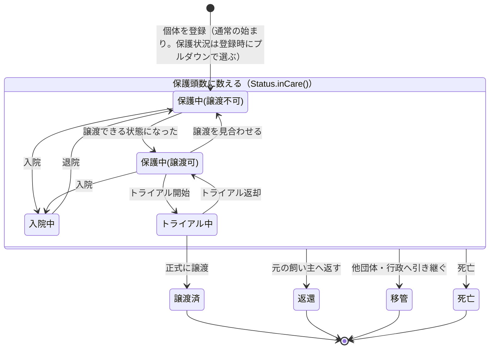

- 図は業務で想定している流れ。保護状況は個体の新規登録（F-08）・編集（F-10）のプルダウンで8種類から選ぶので、システムは図に無い変更も止めない（入力ミスを直せるようにするため）。
- 新規登録画面の保護状況の初期値は保護中(譲渡不可)。
- 保護状況を変えるのは個体の登録・編集だけ。イベントを完了にしても変わらない。
- トライアル中・譲渡済のときは里親の選択が必須。それ以外の保護状況で保存すると、里親との紐づきは外れる（F-08・F-10）。
- 保護頭数が定員に達しても、登録・保護中への変更は止めない。新規登録画面を開いたとき（F-07）と、登録・編集で保護頭数が増えて定員以上になったとき（F-08・F-10）にメッセージを出す。
- 譲渡済・返還・移管・死亡は記録として残す状態で、保護頭数には数えない。
- `Status.inCare()`（`ADOPTABLE` `NOT_ADOPTABLE` `HOSPITALIZED` `TRIAL` の4つ）を使うのは、トップページの保護頭数（F-01）、個体一覧の絞り込みの初期値（F-05）、定員の判定（F-07・F-08・F-10）、イベント登録・編集の個体の選択肢とチェック（F-14〜F-17）。
- inCare に入らない保護状況の個体には、新しいイベントを登録できない（F-15 で「選択できない個体です」）。編集（F-17）では、そのイベントに今付いている個体だけはそのまま保存できる。

#### イベントの対応状況（`events.done`）

|状態|`done`|`staff`|次の状態へ進む操作|
|---|:---:|---|---|
|未対応|false|null|スタンプ欄をクリック → F-18 → 対応済|
|対応済|true|完了にしたスタッフ|済スタンプをクリック → F-34 → 未対応|

- 新規登録（F-15）したイベントは未対応から始まる。対応状況が変わるのは F-18 と F-34 だけで、編集（F-17）では変わらない。
- F-18 はすでに対応済なら何もしない。F-34 はすでに未対応なら何もしない。F-34 で未対応に戻すと、`staff` も null に戻る。
- スタンプ欄を操作できるのは管理ユーザー・常勤スタッフだけ（S-07・S-08）。ボランティアには対応状況を文字で出す。どちらの操作も確認ダイアログを出してから送る。
- 操作後の戻り先は、押した場所で変わる（フラッシュメッセージは出さない）。カレンダー（S-07）の概要ペインから押したときは同じイベントの概要を開き直し、イベント詳細（S-08）から押したときは詳細に戻る。
- 対応済のスタッフが削除されると、`staff` は null になる（`ON DELETE SET NULL`）。対応済のままで、S-08 の「対応スタッフ」欄だけが空になる。

<br>

## 改訂履歴

|日付|内容|
|---|---|
|2026-09-29|初版|
|2026-10-07|実装に合わせて全章を改訂（実装反映版）|
|2026-10-14|修正版。完成版のアプリに合わせて書き直し、定員のメッセージ・一覧の件数と保護状況・特記事項の改行・空欄の null 保存・全画面の共通部品を反映|
